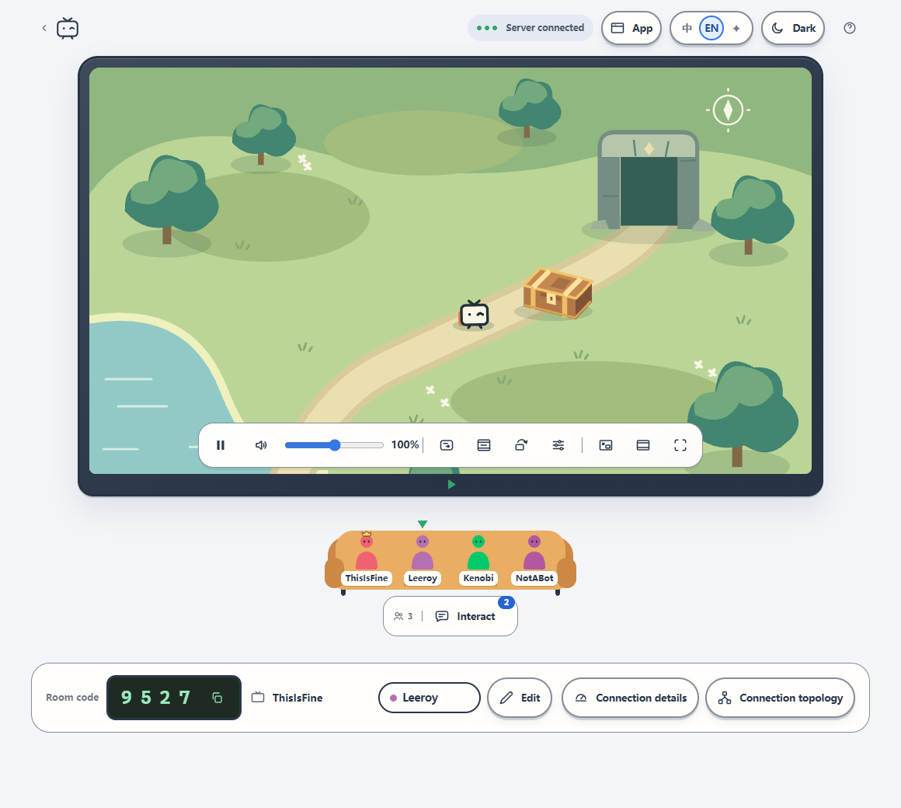

<h1 align="center"></h1>
<p align="center"><strong>Pasilip naman!</strong><br>Private screen sharing for you and up to 20 friends.</p>
<p align="center">
  <a href="./docs/guide/getting-started.md">Get started</a> ·
  <a href="./cmd/silip-app/DEVELOPMENT.md#run-from-source">Build from source</a> ·
  <a href="./docs/guide/README.md">Documentation</a>
</p>
<p align="center">
  <a href="./LICENSE"></a>
  
  
</p>
<p align="center">English · <a href="./README.zh-CN.md">简体中文</a></p>

Silip (Tagalog for "to peek") is a free, open-source screen sharing tool for
private watch parties with friends: games, movie nights, drawings and photos. Choose what to share and send
an invitation. Your friends watch in their browsers. You can also self-host Silip
on your own server.

<details open>
<summary>A little room · Show / hide animation</summary>

<p align="center"></p>

</details>

[Features](#features) · [Get started](#get-started) · [Self-hosting](#self-hosting) · [Contributing](#contributing)

## Features

- **Watch without installing.** Friends join by invitation in a desktop or mobile browser.
- **Share from Silip App or an existing Silip site.** Choose a screen, window, browser tab or camera; available sources and audio depend on the platform.
- **Direct connections first.** Media travels between participants where possible (P2P). A self-hosted server can provide automatic media forwarding (SFU) as a fallback.
- **Rooms you control.** Invitations, room codes and optional room passwords, for one host and up to 20 viewers.
- **Talk and chat together.** Join room voice, send messages and reactions, or enable on-screen chat.
- **Hand control to friends.** Share an App window or screen and approve remote control. Allow friends to play together with shared keyboard/mouse or supported gamepads; take control back at any time. [Setup guide](./docs/guide/remote-control.md).
- **Flexible viewing.** Light and dark themes, playback controls, picture-in-picture and a connection topology view.
- **One program to host a site.** Web UI, room management and optional media forwarding are packaged together.

<p align="center">
  <picture>
    <source media="(prefers-color-scheme: dark)" srcset="./docs/assets/room-en-dark.png">
    
  </picture><br>
  <sub>Interface preview · Sample room with a generated game scene</sub>
</p>

## Get started

**To watch:** open the invitation your friend sends you. Select **Play** if the
picture does not start automatically.

**To share:** [build Silip App from source](./cmd/silip-app/DEVELOPMENT.md#run-from-source),
run it, choose **Public invite**, then **Open Silip**.

<p align="center"></p>

1. Select **Start sharing**, then choose the picture and audio to share.
2. Select **Copy invite link** and send it to your friends. Keep the sharing tab open.

Open **Interact → Voice** to talk together, with or without picture sharing.
The Host opens voice; everyone joins to listen and chooses when to turn on their microphone.

Silip follows your system language: Chinese or English, with English as the fallback.
Use **中 / EN / ✦** in the header to switch language or try the visual mode.
The App can create a local room or temporary public invitation, and stays
available to supply capture for an approved site. Keep it running while sharing.

[**Illustrated getting started →**](./docs/guide/getting-started.md) · [**Troubleshooting →**](./docs/guide/troubleshooting.md)

Browser capture requires HTTPS or `localhost`.
The App's Local room and temporary public link use P2P and need a usable
UDP connection between participants. For campus
networks, failed media connections or virtual LANs, see [network checks and connection options](./docs/guide/network.md).

## Self-hosting

Deploy Silip Server to run a site for your group.

<p><a href="./docs/operations/self-hosting.md#docker-compose"></a></p>

Silip Server runs on Windows x64 and Linux x64/ARM64, with the web interface built in.
Build it from source, or download the Server package for Linux x64 (`silip-<revision>-runtime.tar.gz`)
or ARM64 (`silip-<revision>-linux-arm64-runtime.tar.gz`),
extract it, and run:

```sh
./silip-server
```

Windows x64 uses `silip-<revision>-windows-amd64-runtime.zip`; extract it and run
`./silip-server.exe` in PowerShell. The same configuration applies.

Open `http://localhost:8787` to try it locally. For a public site, configure your
domain, HTTPS reverse proxy and STUN address. Room data is stored in SQLite.
For containers, use the [Docker Compose setup](./docs/operations/self-hosting.md#docker-compose).

[**Deploy your own site →**](./docs/operations/self-hosting.md) · [Configuration](./docs/standards/configuration.md) · [Run from source](./docs/README.md#run-from-source)

## Contributing

Bug reports, translations, documentation improvements and pull requests are welcome.
See [ways to contribute](./CONTRIBUTING.md#ways-to-help) or
[help translate Silip](./docs/guide/translating.md). Use the
[repository layout](./docs/standards/engineering.md#repository-layout) to find your way around.

## Credits and license

Silip is based on [Piik](https://github.com/TNTcraftHIM/Piik) by TNTcraft and Piik
contributors. Thank you for building and open-sourcing it.

Silip's code is [MIT licensed](./LICENSE), keeping Piik's original copyright notice.
Dependencies retain their own [licenses and notices](./licenses/README.md).
