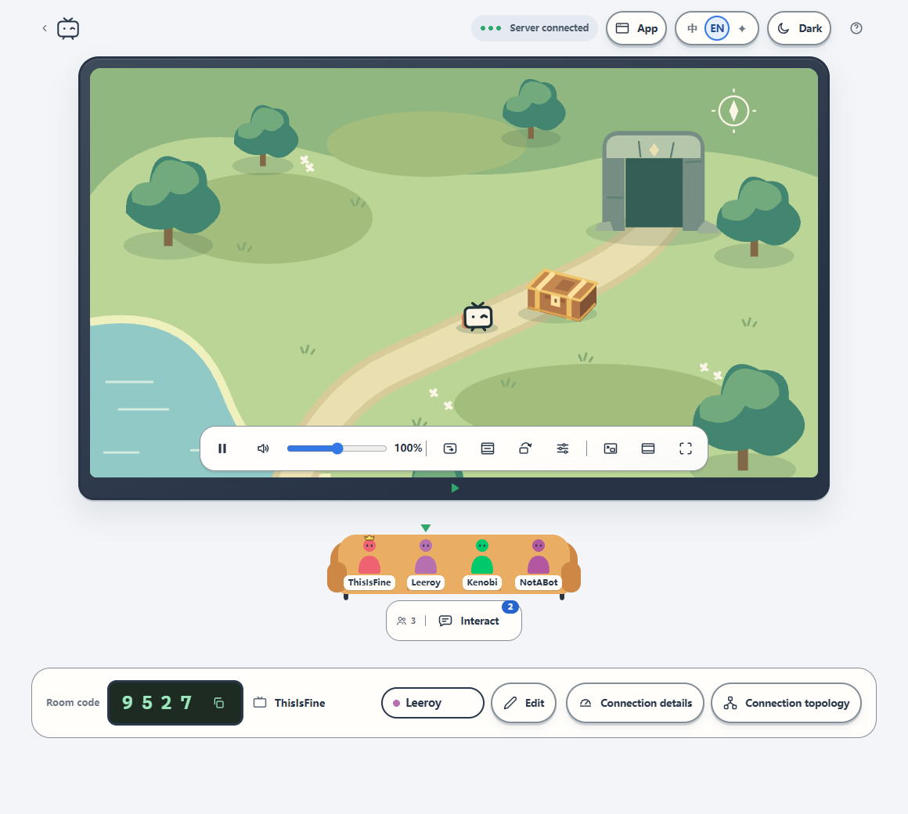

<p align="center"></p>
<h1 align="center">Piik</h1>
<p align="center"><strong>Güzel şeyleri paylaşın.</strong><br>Sizin ve en fazla 20 arkadaşınız için gizli ekran paylaşımı.</p>
<p align="center">
  <a href="https://piik.tv">Web Sitesi</a> ·
  <a href="https://github.com/TNTcraftHIM/Piik/releases">İndir</a> ·
  <a href="https://atomgit.com/TNTcraftHIM/Piik/releases">AtomGit yansısı</a> ·
  <a href="https://demo.piik.tv">Çevrimiçi kullan</a> ·
  <a href="https://piik.tv/docs/?lang=en">Dokümantasyon</a>
</p>
<p align="center">
  <a href="./LICENSE"></a>
  
  
</p>
<p align="center"><a href="./README.md">English</a> · <a href="./README.zh-CN.md">简体中文</a> · Türkçe</p>

Piik, arkadaşlarınızla özel canlı yayınlar (oyunlar, film geceleri, çizimler ve fotoğraflar) yapmak için ücretsiz, açık kaynaklı bir ekran paylaşım aracıdır. Ne paylaşacağınızı seçin ve bir davet gönderin. Arkadaşlarınız tarayıcılarından izler. Ayrıca Piik'i kendi sunucunuzda da barındırabilirsiniz.

<details open>
<summary>Küçük bir oda · Animasyonu göster / gizle</summary>

<p align="center"></p>

</details>

[Özellikler](#özellikler) · [Başlangıç](#başlangıç) · [Kendi sunucunuzda barındırma](#kendi-sunucunuzda-barındırma) · [Katkıda bulunma](#katkıda-bulunma)

## Özellikler

- **Kurulum yapmadan izleyin.** Arkadaşlarınız masaüstü veya mobil tarayıcı üzerinden davet bağlantısıyla katılır.
- **Piik App veya mevcut bir Piik sitesinden paylaşın.** Bir ekran, pencere, tarayıcı sekmesi veya kamera seçin; kullanılabilir kaynaklar ve ses desteği platforma bağlıdır.
- **Önce doğrudan bağlantılar.** Medya mümkün olduğunda katılımcılar arasında doğrudan iletilir (P2P). Kendi barındırdığınız bir sunucu, yedek olarak otomatik medya yönlendirme (SFU) sağlayabilir.
- **Kontrolü sizde olan odalar.** Bir ev sahibi ve en fazla 20 izleyici için davetler, oda kodları ve isteğe bağlı oda parolaları.
- **Birlikte konuşun ve sohbet edin.** Oda sesli sohbetine katılın, mesaj ve tepki gönderin veya ekran üstü sohbeti etkinleştirin.
- **Kontrolü arkadaşlarınıza devredin.** Piik App ile bir pencereyi veya ekranı paylaşın ve uzaktan kontrolü onaylayın. Arkadaşlarınızın paylaşılan klavye/fare veya desteklenen oyun kumandalarıyla birlikte oynamasına izin verin; kontrolü istediğiniz zaman geri alın. [Kurulum kılavuzu](./docs/guide/remote-control.md).
- **Esnek izleme.** Açık ve koyu temalar, oynatma kontrolleri, resim içinde resim (PiP) ve bağlantı topolojisi görünümü.
- **Bir site barındırmak için tek program.** Web arayüzü, oda yönetimi ve isteğe bağlı medya yönlendirme tek pakette sunulur.

<p align="center">
  <picture>
    <source media="(prefers-color-scheme: dark)" srcset="./docs/assets/room-en-dark.png">
    
  </picture><br>
  <sub>Arayüz önizlemesi · Oluşturulmuş bir oyun sahnesine sahip örnek oda</sub>
</p>

## Başlangıç

**Bir davet mi aldınız?** Tam bağlantıyı bilgisayarınızdaki veya telefonunuzdaki bir tarayıcıda açın. Görüntü otomatik olarak başlamazsa **Play** seçeneğini seçin.

1. **Nasıl paylaşacağınızı seçin.** Bilgisayarda bir ekran, pencere veya tarayıcı sekmesi paylaşmak için [Piik online](https://demo.piik.tv) adresini açın. Kamera erişimi olan bir telefon tarayıcısı kamerasını paylaşabilir. Piik App ile paylaşmak için [uygulamayı indirin](https://piik.tv/#download), ardından masaüstünde arşivden çıkarıp açın veya Android'de kurup açın. Başka bir ağdaki arkadaşlarınızı davet etmek için **Public invite**, ardından **Open Piik** seçeneğini seçin.
2. **Start sharing** seçeneğine tıklayın ve arkadaşınızın ne göreceğini seçin. Ses paylaşmak istiyorsanız kaynak seçici sunduğunda sesi etkinleştirin.
3. Önizlemeyi gördüğünüzde **Admission** altından **Copy** seçeneğini seçin ve tam bağlantıyı arkadaşınıza gönderin. Paylaşım sekmesini açık tutun. Uygulamayı kullanıyorsanız onu da çalışır durumda tutun.

<p align="center"></p>

Görüntü paylaşımı olsun veya olmasın birlikte konuşmak için **Interact → Voice** bölümünü açın.
Ev sahibi sesli sohbeti açar; herkes dinlemek için katılır ve mikrofonunu ne zaman açacağını kendi seçer.

Piik sistem dilinizi takip eder: Çince veya İngilizce (varsayılan yedek olarak İngilizce).
Dili değiştirmek veya görsel modu denemek için üst bilgideki **中 / EN / ✦** düğmesini kullanın.
Uygulama yerel bir oda veya geçici bir genel davet oluşturabilir ve onaylı bir site için görüntü yakalama sağlamak üzere kullanılabilir kalır. Paylaşım sırasında çalışır durumda tutun.

[**Resimli başlangıç kılavuzu →**](./docs/guide/getting-started.md) · [**Sorun giderme →**](./docs/guide/troubleshooting.md)

**`piik-app`** ile başlayan bir indirme paketi seçin. Kılavuz kurulum, kaynak seçimi ve davetleri kapsar.

Tarayıcı yakalama HTTPS veya `localhost` gerektirir.
Uygulamanın geçici genel bağlantısı ve çevrimiçi sürüm P2P kullanır ve katılımcılar arasında kullanılabilir bir UDP bağlantısına ihtiyaç duyar. Kampüs ağları, başarısız medya bağlantıları veya sanal LAN'lar için [ağ kontrolleri ve bağlantı seçeneklerine](./docs/guide/network.md) bakın.

## Kendi sunucunuzda barındırma

Grubunuz için bir site çalıştırmak üzere Piik Server'ı dağıtın.

<p><a href="./docs/operations/self-hosting.md#docker-compose"></a></p>

Piik Server, yerleşik web arayüzü ile Windows x64 ve Linux x64/ARM64 üzerinde çalışır.
Linux x64 (`piik-<revision>-runtime.tar.gz`) veya ARM64 (`piik-<revision>-linux-arm64-runtime.tar.gz`) için Server paketini indirin, arşivden çıkarın ve çalıştırın:

```sh
./piik-server
```

Windows x64 için `piik-<revision>-windows-amd64-runtime.zip` kullanılır; arşivden çıkarın ve PowerShell'de `./piik-server.exe` komutunu çalıştırın. Aynı yapılandırma geçerlidir.

Yerel olarak denemek için `http://localhost:8787` adresini açın. Genel bir site için alan adınızı, HTTPS ters vekil sunucunuzu (reverse proxy) ve STUN adresinizi yapılandırın. Oda verileri SQLite içinde saklanır.
Konteynerler için [Docker Compose kurulumunu](./docs/operations/self-hosting.md#docker-compose) kullanın.

[**Kendi sitenizi dağıtın →**](./docs/operations/self-hosting.md) · [Yapılandırma](./docs/standards/configuration.md) · [Kaynaktan çalıştırma](./docs/README.md#run-from-source)

## Katkıda bulunma

Hata bildirimleri, çeviriler, dokümantasyon iyileştirmeleri ve pull request'ler memnuniyetle karşılanır.
[Katkıda bulunma yollarına](./CONTRIBUTING.md#ways-to-help) bakın veya [Piik'in çevrilmesine yardımcı olun](./docs/guide/translating.md). Yolunuzu bulmak için [depo yapısını](./docs/standards/engineering.md#repository-layout) kullanın.

## Lisans

Piik'e ait kodlar [MIT lisanslıdır](./LICENSE). Bağımlılıklar kendi [lisanslarını ve bildirimlerini](./licenses/README.md) korur.

## Proje etkinliği

<p align="center">
  <a href="https://trendshift.io/repositories/236065"></a>
</p>
<p align="center">
  <a href="https://www.star-history.com/#TNTcraftHIM/Piik&amp;Date">
    <picture>
      <source media="(prefers-color-scheme: dark)" srcset="https://api.star-history.com/svg?repos=TNTcraftHIM/Piik&amp;type=Date&amp;theme=dark">
      
    </picture>
  </a>
</p>
