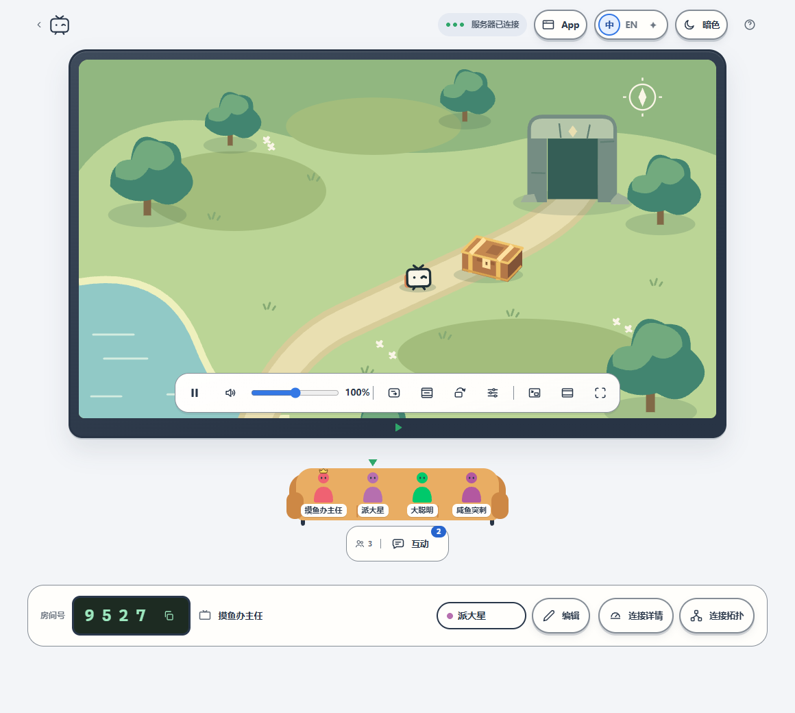

<h1 align="center">Piik</h1>

<strong>来，看点 好康的。</strong> 私密屏幕共享，邀请最多 20 位朋友观看。

  <a href="https://piik.tv/?lang=zh-CN">官网</a> ·
  <a href="https://github.com/TNTcraftHIM/Piik/releases">下载</a> ·
  <a href="https://atomgit.com/TNTcraftHIM/Piik/releases">AtomGit 镜像</a> ·
  <a href="https://demo.piik.tv">在线版</a> ·
  <a href="https://piik.tv/docs/zh/">文档中心</a>

  
  
  

<a href="./README.md">English</a> · 简体中文

Piik 是一个免费开源的私密屏幕共享工具，适合游戏直播、一起看电影、展示绘画或分享照片。
选择画面，把邀请链接发给朋友，对方用浏览器即可观看。也支持自部署，搭建自己的 Piik 站点。

客厅小剧场 · 展开 / 收起动画

[功能](#功能) · [开始使用](#开始使用) · [自行部署](#自行部署) · [参与贡献](#参与贡献)

## 功能

- **观看无须安装。** 朋友通过邀请链接，用电脑或手机浏览器加入。
- **用 Piik App 或已有 Piik 站点分享。** 支持屏幕、窗口、浏览器标签页和摄像头；可选来源与音频能力取决于平台。
- **优先直接连接。** 画面优先在设备之间传输（P2P）。Piik Server 可提供 SFU 兜底。
- **房间由你管理。** 支持邀请链接、房间号和可选的房间密码，一位房主、最多 20 位观众。
- **边看边聊。** 加入房间语音，发送文字和表情，也可开启弹幕。
- **让朋友接手操作。** 通过 Piik App 分享窗口或屏幕并授权远控，也可允许多人共用键鼠或使用受支持的手柄一起玩，随时结束控制。[远程控制与多人同乐](https://piik.tv/docs/zh/remote-control.html)。
- **灵活的观看方式。** 支持深浅主题、播放控制、画中画和连接拓扑查看。
- **一个程序就能建站。** 网页、房间管理和可选的媒体转发打包在同一服务端程序中。

  <picture>
    <source media="(prefers-color-scheme: dark)" srcset="./docs/assets/room-zh-dark.png">
    
  </picture> 
  界面预览 · 示例房间与生成的游戏画面

## 开始使用

以下步骤适用于 **2.x 正式版**。收到 3.0 内测包或邀请的测试者，请看 [Piik 3.0 内测文档](./docs/guide/README.zh-CN.md)。

**观看分享：** 打开朋友发来的邀请链接。画面没有自动播放时，点击**播放**即可。

**分享画面：** 推荐下载 **Piik App**。想免安装，也可以打开在线版直接创建房间。

| 从这里开始 | 需要做什么 |
| --- | --- |
| [使用在线版](https://demo.piik.tv) | 用电脑浏览器分享画面；手机浏览器支持摄像头访问时，也可选择摄像头分享。 |
| [下载 Piik App](https://piik.tv/?lang=zh-CN#download) | 电脑上解压程序包，手机或平板安装 App。打开 Piik，选择**公网邀请**，点击**进入 Piik**。 |

1. 点击**开始分享**，选择要分享的画面和声音。
2. 在**准入方式**里点**复制**，把邀请链接发给朋友。分享期间保持标签页打开。

打开 **互动 → 语音** 即可一起聊天，开播前后都能使用。
房主开启语音后，大家自行加入收听，想说话时再打开自己的麦克风。

Piik 默认跟随浏览器语言，未提供相应界面语言时使用英文。
顶部用 **中** 或 **EN** 切换，点旁边的下拉箭头可选其他语言或**纯视觉**。
Piik App 可创建本地房间或临时公网邀请，也能在后台为已授权站点提供采集能力。分享期间需保持 App 运行。

[第一次用 Piik](https://piik.tv/docs/zh/getting-started.html) · [疑难解答](https://piik.tv/docs/zh/troubleshooting.html)

选择以 **`piik-app`** 开头的程序包；教程介绍安装、选择画面和邀请朋友的完整步骤。

浏览器采集需要 HTTPS 或 `localhost`。Piik App 的公网邀请和在线版使用 P2P，
参与者之间需要可用的 UDP 通路。校园网、画面连接失败或虚拟局域网的用法，见[进阶网络排查](https://piik.tv/docs/zh/network.html)。

## 自行部署

本分支开发内部测试的 **3.0 Rust Server**。请使用匹配的 Server 与网页程序包，
按 [Rust 启动与部署说明](./prototype/channel-server/README.md#run)操作。
已发布的 2.x 请继续使用 [2.x 部署指南](./docs/operations/self-hosting.zh-CN.md)。

在本机试用 3.0 时，将程序包中的 `web/` 保留在可执行文件旁，为新站点设置私密 owner seed，
再运行 `./piik-server`（Windows 使用 `./piik-server.exe`）。打开启动时打印的地址；
独立 Server 默认是 `http://127.0.0.1:8791`。
[程序包启动步骤](./prototype/channel-server/README.md#packaged-server)提供两种终端的命令。

[3.0 部署步骤](./prototype/channel-server/README.md#public-origin-and-udp)介绍 HTTPS、
固定媒体 UDP 和公网地址映射。Rust Server 读取进程环境变量，不会自动读取 `.env`。
站点转发默认关闭，可按需启用。[站点转发设置](./prototype/channel-server/README.md#site-forwarding)

[**3.0 Server 部署 →**](./prototype/channel-server/README.md#run) · [环境变量模板](./deploy/container/.env.example) · [从源码运行](./docs/README.md#run-from-source)

## 参与贡献

欢迎反馈问题、参与翻译、改进文档或贡献代码。
从[社区参与方式](./CONTRIBUTING.md#ways-to-help)或
[翻译教程](./docs/guide/translating.zh-CN.md)开始，也可以从
[项目目录说明](./docs/standards/engineering.md#repository-layout)了解代码结构。

## 许可

Piik 自有代码采用 [MIT 许可](./LICENSE)，依赖保留各自的[许可与声明](./licenses/README.md)。

## 项目动态

  

  <a href="https://www.star-history.com/#TNTcraftHIM/Piik&amp;Date">
    <picture>
      <source media="(prefers-color-scheme: dark)" srcset="https://api.star-history.com/svg?repos=TNTcraftHIM/Piik&amp;type=Date&amp;theme=dark">
      
    </picture>
  </a>

