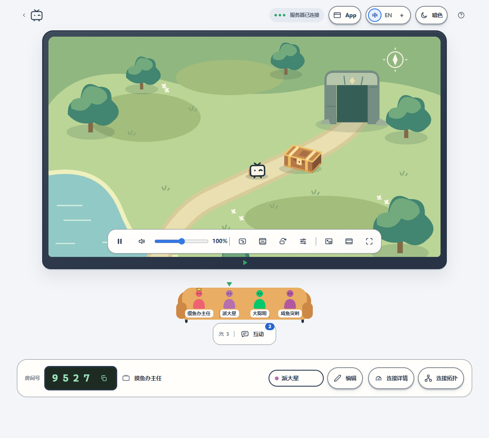

<h1 align="center"></h1>
<p align="center"><strong>Pasilip naman!</strong><br>私密屏幕共享，邀请最多 20 位朋友观看。</p>
<p align="center">
  <a href="./docs/guide/getting-started.zh-CN.md">开始使用</a> ·
  <a href="./cmd/silip-app/DEVELOPMENT.md#run-from-source">从源码构建</a> ·
  <a href="./docs/guide/README.zh-CN.md">文档</a>
</p>
<p align="center">
  <a href="./LICENSE"></a>
  
  
</p>
<p align="center"><a href="./README.md">English</a> · 简体中文</p>

Silip 是一个免费开源的私密屏幕共享工具，适合游戏直播、一起看电影、展示绘画或分享照片。
选择画面，把邀请链接发给朋友，对方用浏览器即可观看。也支持自部署，搭建自己的 Silip 站点。

<details open>
<summary>客厅小剧场 · 展开 / 收起动画</summary>

<p align="center"></p>

</details>

[功能](#功能) · [开始使用](#开始使用) · [自行部署](#自行部署) · [参与贡献](#参与贡献)

## 功能

- **观看无须安装。** 朋友通过邀请链接，用电脑或手机浏览器加入。
- **用 Silip App 或已有 Silip 站点分享。** 支持屏幕、窗口、浏览器标签页和摄像头；可选来源与音频能力取决于平台。
- **优先直接连接。** 画面优先在设备之间传输（P2P），自建站点可启用媒体转发（SFU）自动兜底。
- **房间由你管理。** 支持邀请链接、房间号和可选的房间密码，一位房主、最多 20 位观众。
- **边看边聊。** 加入房间语音，发送文字和表情，也可开启弹幕。
- **让朋友接手操作。** 通过 Silip App 分享窗口或屏幕并授权远控，也可允许多人共用键鼠或使用受支持的手柄一起玩，随时结束控制。[查看设置方法](./docs/guide/remote-control.zh-CN.md)。
- **灵活的观看方式。** 支持深浅主题、播放控制、画中画和连接拓扑查看。
- **一个程序就能建站。** 网页、房间管理和可选的媒体转发打包在同一服务端程序中。

<p align="center">
  <picture>
    <source media="(prefers-color-scheme: dark)" srcset="./docs/assets/room-zh-dark.png">
    
  </picture><br>
  <sub>界面预览 · 示例房间与生成的游戏画面</sub>
</p>

## 开始使用

**观看分享：** 打开朋友发来的邀请链接。画面没有自动播放时，点击**播放**即可。

**分享画面：** [从源码构建 Silip App](./cmd/silip-app/DEVELOPMENT.md#run-from-source)，
运行后选择**公网邀请**，点击**进入 Silip**。

<p align="center"></p>

1. 点击**开始分享**，选择要分享的画面和声音。
2. 点击**复制邀请链接**，发给朋友。分享期间保持标签页打开。

打开 **互动 → 语音** 即可一起聊天，开播前后都能使用。
房主开启语音后，大家自行加入收听，想说话时再打开自己的麦克风。

Silip 默认跟随系统语言，中文系统显示简体中文，其他语言显示英文。
顶部的 **中 / EN / ✦** 可切换中英文或体验纯视觉模式。
Silip App 可创建本地房间或临时公网邀请，也能在后台为已授权站点提供采集能力。分享期间需保持 App 运行。

[**图文上手教程 →**](./docs/guide/getting-started.zh-CN.md) · [**问题排查 →**](./docs/guide/troubleshooting.zh-CN.md)

浏览器采集需要 HTTPS 或 `localhost`。Silip App 的本地房间和公网邀请使用 P2P，
参与者之间需要可用的 UDP 通路。校园网、画面连接失败或虚拟局域网的用法，见[网络排查与连接方案](./docs/guide/network.zh-CN.md)。

## 自行部署

部署 Silip Server，为朋友搭建自己的站点。

<p><a href="./docs/operations/self-hosting.zh-CN.md#使用-docker-compose"></a></p>

Silip Server 是内置网页界面的独立程序，支持 Windows x64 和 Linux x64／ARM64。
根据服务器架构下载 Linux x64 的 `silip-<revision>-runtime.tar.gz` 或 ARM64 的
`silip-<revision>-linux-arm64-runtime.tar.gz`，解压后运行：

```sh
./silip-server
```

Windows x64 可下载 `silip-<revision>-windows-amd64-runtime.zip`，解压后在 PowerShell
运行 `./silip-server.exe`；配置方式相同。

打开 `http://localhost:8787` 即可在本机试用。对外提供服务时，
再配置域名、HTTPS 反向代理和 STUN 地址。房间数据保存在 SQLite 中。
也可以使用 [Docker Compose 部署](./docs/operations/self-hosting.zh-CN.md#使用-docker-compose)。

[**部署自己的站点 →**](./docs/operations/self-hosting.zh-CN.md) · [配置参考](./docs/standards/configuration.md) · [从源码运行](./docs/README.md#run-from-source)

## 参与贡献

欢迎反馈问题、参与翻译、改进文档或贡献代码。
从[社区参与方式](./CONTRIBUTING.md#ways-to-help)或
[翻译教程](./docs/guide/translating.zh-CN.md)开始，也可以从
[项目目录说明](./docs/standards/engineering.md#repository-layout)了解代码结构。

## 致谢与许可

Silip 基于 TNTcraft 与 Piik 贡献者开发的 [Piik](https://github.com/TNTcraftHIM/Piik)，感谢原作者的开源。

Silip 代码采用 [MIT 许可](./LICENSE)，保留 Piik 的原始版权声明；依赖保留各自的[许可与声明](./licenses/README.md)。
