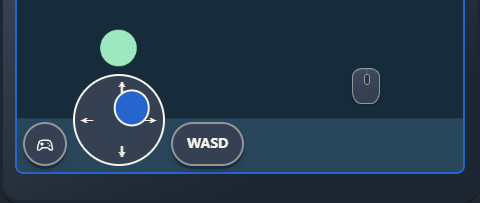

# 远程控制与多人同乐

[English](./remote-control.md) · 简体中文 · [文档中心](./README.zh-CN.md)

让朋友操作共享的电脑，或一起玩本地多人游戏。房主通过 App 分享窗口或屏幕，朋友在浏览器中加入。

## 开始远程控制

1. 通过 Piik App 的 **程序 / 窗口** 或 **屏幕** 开始分享。
2. 打开画面下方的 **远程控制** 并开启开关，默认使用 **每次询问**。
3. 朋友在播放控制栏中点击 **请求控制**。收到请求后，房主在分享页面选择 **允许控制**。

分享窗口时，允许控制后请切回该窗口。
其他窗口处于前台时，远程输入会暂停；切回即可继续。

请使用更新后的 App 和房间站点，更新后让观众刷新页面。
观众需要 HTTPS 或本机页面建立加密输入连接。普通局域网 HTTP 可以观看，但不提供远控。
浏览器和摄像头采集不支持接收远程操作。

## 多人同乐

1. 按上述步骤开启 **远程控制**，再打开 **允许多人同时控制**。
   每个新共享源默认关闭此设置。更改它会结束当前控制请求和授权，授权方式和密码保持不变。
2. 每位朋友点击 **请求控制**，按普通远控所用的授权方式取得控制权。
3. 在游戏中给各位玩家分配不同键位，例如 WASD 和方向键。游戏本身需要支持共用键盘。

房主和获准的朋友共用电脑现有的键盘和鼠标。Piik 分别记录各人的键盘按键和鼠标按钮，
退出时只释放该玩家的输入。共用键鼠无须额外驱动。一次授权即可使用键鼠和受支持的可选手柄，
「允许多人同时控制」按获准观众人数计算，不按输入设备计算。只有一位获准观众时可以插入文字；
两位及以上观众获准后，插入文字暂时停用，实体键盘按键仍可使用。
旧版客户端仍采用单人控制。请将房主 App 和房间站点更新到支持多人同乐的版本，
并让各位观众刷新页面后再协作。

大家操作的是同一个鼠标指针，获准玩家的移动和点击会共同生效。
房主可以通过结束控制按钮或停止快捷键结束远程操作。

加入协作后，观众席的小人身上会出现鼠标标记，房主和观众都能看到参与者。
结束控制后，标记随之消失。

## 手柄

手柄所需的外部组件由房主从官方渠道安装。Piik 不在任何平台捆绑、下载或安装第三方手柄 SDK 和驱动。

| 房主系统 | 当前手柄支持 |
| --- | --- |
| Windows x64 | 安装 [ViGEmBus 1.22.0](https://github.com/nefarius/ViGEmBus/releases/tag/v1.22.0)，无需额外 DLL。 |
| Linux | 原型使用系统 uinput，需要 App 运行用户具有设备写入权限。 |
| macOS | 当前 App 暂不提供独立手柄；原生后端需要 Apple 授权。 |

每位远程玩家可以将一个浏览器识别的手柄映射为 **Windows x64 房主**上的独立 Xbox 360 手柄。
Piik 负责传输和映射输入，房主安装的可选 ViGEmBus 驱动负责创建虚拟设备。

1. 房主从官方 [ViGEmBus 1.22.0 发布页](https://github.com/nefarius/ViGEmBus/releases/tag/v1.22.0)
   安装驱动，并按安装程序提示重启。ViGEm 已结束维护；1.22.0 是最终安装程序，移除了旧更新器。
   已安装的房主可以继续使用现有驱动。
2. 解压并打开更新后的 Windows x64 Piik App 程序包，然后开启 **远程控制**。
   App 会检测已安装的驱动，无需手动复制 DLL 或配置 SDK。
3. 每位朋友在自己的电脑上连接标准布局手柄，打开观看页面，按一下手柄按钮让浏览器识别。
   取得远程控制授权后，Piik 自动使用浏览器标准映射下的第一个已连接手柄，无须再次申请权限。
4. 保持观看页面在前台，在游戏中以手柄玩家身份加入。

XInput 总共提供四个手柄位，包括房主本机已连接的手柄。手柄位已满时，断开不使用的手柄或结束该观众的远程控制即可释放。
Piik 不指定游戏中的玩家编号，请使用游戏自己的加入和分配功能。
每位获准观众使用各自的虚拟手柄。断开手柄连接会移除该设备，保留远程控制权限；
结束远程控制会释放该观众的全部输入。观看页面或共享窗口失去焦点时，手柄按键和摇杆会回到中立状态。

手柄没有响应时，请检查房主的驱动和 App 是否支持该功能，再关闭并重新开启 **远程控制**。
不装手柄驱动仍可共用键鼠、使用普通远控。

## 用手机玩电脑游戏（屏幕摇杆）

1. 在手机上轻点画面呼出播放控制栏，点击标有 **请求控制** 的鼠标图标。
   使用 **每次询问** 时，房主在 **远程控制** 面板中点击 **允许控制**。
2. 控制生效后，点击画面左下角的手柄图标，摇杆会在旁边展开。
3. 朝想移动的方向拖动摇杆。抬手后摇杆归中，移动输入随即释放。
   再点一次手柄图标可收起摇杆。

*示例画面中的观众端控件。*

- **找不到手柄图标？** 手机等触屏设备在远程控制生效后才会显示屏幕摇杆。
  如果请求还在等待，请让房主先授权。
- **摇杆上显示 W、A、S、D？** 此时摇杆发送这四个字母键。向左上推会同时按住 W 和 A。
  模拟左摇杆需要支持多人同乐的版本和房主端的手柄支持，观看设备当前也不能在使用实体手柄。
  Windows x64 房主可按 [手柄](#手柄) 一节检查驱动。
  模拟左摇杆可用时，点 **WASD** 切到键盘移动，再点一次切回模拟左摇杆。
- **连接中断了？** 画面恢复后再次点击 **请求控制**，控制生效后再点手柄图标打开摇杆。

## 结束控制

双方都可以点击 **结束控制**。房主在本机按 **Ctrl+Alt+F10**（Windows）或
**Control+Option+F10**（macOS）可以停止全部远程输入。如与其他应用冲突，可在房主的
**远程控制** 面板中更换功能键。观众可以在 **远程键盘** 中单独调整 **退出控制快捷键**。
快捷键保存在当前站点的浏览器存储中，各站点独立设置。

切换来源或停止分享会关闭远控；连接中断后，玩家需要重新请求。
授权方式会记住，但不会自动开启远控。上次选择 **房间观众** 时，需要点击 **允许观众控制** 后再次生效。
控制密码不会保存。

## 鼠标、触屏与权限

在触屏设备上取得控制权后，点手柄按钮可展开方向控件。

| 操作方式 | 房主收到的输入 | 适用场景 |
| --- | --- | --- |
| 左摇杆 | 模拟左摇杆的轴值。箭头是方向标记。 | 房主支持手柄，且浏览器未识别到标准布局的实体手柄时，可用来控制走路、跑步等渐进移动。 |
| WASD | 按住 W、A、S 或 D，斜向时同时按住两个键。 | 模拟摇杆可用时点 **WASD** 切换，其余情况下方向控件直接发送这些键。 |
| 实体手柄 | 标准手柄按键和左右摇杆。 | 用右摇杆转动游戏视角。Piik 优先使用浏览器识别到的第一个标准布局手柄。 |

用手机操作桌面时，可以轻点画面中的目标，或者用光标触控板微调。两种触摸方式都发送共享画面范围内的光标坐标。需要连续转动鼠标视角时，可在支持的桌面浏览器里开启 **游戏鼠标**。

手机上默认直接触摸画面操作，不显示光标；轻点点击、长按拖动，双指轻点右击、滑动滚动。
捏合可放大或缩小画面，缩放后双指移动用于平移画面，周围允许留黑。在 **播控设置 → 默认触摸方式** 中，也可选择 **光标触控板**。

拖动迷你鼠标可调整工具的位置，轻点即可展开左右键和滚轮。光标位于鼠标左上方，拖动下半部或单指滑动画面时一起移动；到达边缘时，画面会平移留出鼠标的操作空间。
光标停在所分享画面的边缘，留黑只补足工具所需的空间。鼠标展开时，双指缩放、平移会调整本地画面，鼠标留在手边；要滚动远端页面，请滑动鼠标滚轮。
按住鼠标键再移动即可拖拽物体。滚轮轻点为中击、滑动为滚动，长按后移动可进行中键拖动。
独立的缩小按钮可切回迷你鼠标和选定的触摸方式。迷你鼠标贴边闲置后会按播控相同的时长自动收纳，点击露出的部分即可再次展开。
**远程键盘** 提供按键、组合键和文字输入。
电脑上可开启 **游戏鼠标** 连续转动视角，按 **Esc** 释放鼠标。

**房间观众** 允许已加入房间的观众直接取得可用控制权；**控制密码** 要求输入单独设置的密码。
这些设置只对当前分享来源有效。键鼠操作可以超出视频画面边界，请只授权给信任的人。

macOS 需要允许「辅助功能」权限。Linux 需要桌面环境支持 Portal，只支持控制所选屏幕，
不支持单个应用窗口。受系统保护的快捷键和部分游戏不接受模拟输入。
