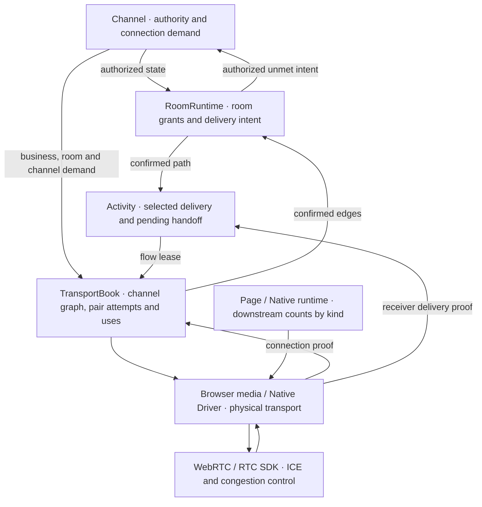

# Channel, Room And Activity Forwarding

The agreed 3.0 topology is **Channel → Room → Activity / 频道 → 房间 → 业务**.
A channel maintains one reusable connection graph, a room exposes its authorized
subgraph, and each publication selects directed delivery paths. The algorithm
below is the implementation baseline. The [version boundary](#version-boundary)
records implementation coverage. [Channel and room authority](./server-hosting-plan.md)

## Route planning procedure

A change in demand, a connection or available capacity wakes the channel's
connection scheduler and affected room planners. The channel admits physical
attempts; each room selects delivery paths on confirmed pairs using current
permissions, payload capabilities and endpoint grants.

| Situation | Method and result |
| --- | --- |
| One waiting receiver | Search eligible edges with BFS for equal hop costs. Seed the search at the source or eligible relays already receiving the stream. Dijkstra can use measured, non-negative additive costs. [Known paths](#finding-a-relay-outside-the-publication) |
| A needed path is incomplete | Select an unverified pair that can connect the reachable sides. Coalesce concurrent requests for the pair and let ICE check its candidates. On confirmation, publish the edge to the pool. [Lazy edge evaluation](#finding-a-relay-outside-the-publication) |
| Several receivers want the same publication | Reuse the live tree and compare feasible extensions within each sender's budget. An exact solver on small known graphs measures the gap for the online heuristic. [Delivery trees](#selecting-delivery-trees) |
| One relay's departure could divide a group | Find connected components and articulation points on confirmed bidirectional links. Try an eligible pair across the components that would separate. [Standby connectivity](#connectivity-and-route-lifetime) |
| A replacement is ready for testing | Keep the current delivery while the receiver checks the new payload. Commit on proof, or release the failed trial. [Route changes](#improving-a-working-path) |

## Scope, Priority And Payload

| Scope | Who decides | How it reaches participants |
| --- | --- | --- |
| Channel | One logical channel authority owns identity, presence and the discoverable room directory. | The channel service authenticates connections and distributes permitted updates and connection signals. Its public entry can use an App's Cloudflare Tunnel or a deployed Server's HTTPS endpoint. |
| Room | Its current host admits members, orders and confirms chat, stores room history and coordinates room voice. | Room commands and replies can travel through the channel WebSocket. Each speaker publishes audio on the authorized room paths to their listeners. |
| Activity | A sharer publishes a screen or offers a file. Viewers and downloaders request it within room permissions. | A ready peer path or authorized forwarding service carries the assigned traffic. The room history carries the attachment description and bounded thumbnail. |

The signaling plane carries identity, presence, room discovery and connection
negotiation. The data plane delivers the requested voice, screen and file
payloads. Room chat also uses the channel WebSocket to reach the room host,
which authorizes, orders and confirms messages. The channel carries these
messages without assuming ownership of their history.
LiveKit likewise uses a WebSocket for signaling and WebRTC connections to its
SFU for media. Jitsi separates signaling, conference coordination and the
media bridge. [LiveKit client protocol](https://docs.livekit.io/reference/internals/client-protocol/) · [Jitsi architecture](https://jitsi.github.io/handbook/docs/architecture/)

Each channel has one logical signaling authority. With an App public invite,
`cloudflared` exposes the host's local Piik service. A direct or proxied Server
can expose the same protocol. STUN can be configured independently for address
discovery. Room hosts and clients originate messages through that entry. Passing
a room command through the channel preserves the room's authority. If its host
is offline, the channel can still serve the permitted directory summary. A
Server operating a hosted channel can continue confirming room work when the
human creator is offline. [Channel modes](./server-hosting-plan.md#channel-modes) · [Cloudflare Tunnel](https://developers.cloudflare.com/cloudflare-one/networks/connectors/cloudflare-tunnel/)

### One channel connection graph

The channel maintains one graph of real peer connections. Room membership
and grants select a subgraph of that same graph. Entering the channel starts
discovery and can establish a useful standby neighbor, including in the
lobby. Entering a room creates demand for useful in-room connections
before anyone starts sharing. Room and activity demand grow the shared graph
from the endpoints up. The channel can then fill a missing link between
components or add an alternate path around a relay. Capacity is used first
where the endpoints actually need to communicate. A room can have many
neighbors, cycles and multiple paths.
Different rooms may overlap. Each endpoint pair has one transport owner and
one pending connection attempt.

At time $t$, let $G_t=(V_t,E_t)$ be the channel graph. A vertex is an endpoint
session. A pair $\{u,v\}$ enters $E_t$ when its two confirmations match the
current connections of $u$ and $v$. A pending pair can already have demand.
For a publication $p$ in room $r$, $E_{r,p}(t)$ contains the directions of
confirmed pairs that the room authorizes and the payload can use. A relay
assignment also requires capacity at the sending endpoint.
[TransportBook](../../prototype/channel-core/src/transport.rs)

The signaling authority supplies eligible candidates on demand. With n endpoints
a full mesh has n(n−1)/2 pairs and n−1 neighbors per endpoint. Keeping at
most d pending or established pairs per endpoint bounds the total by floor(nd/2).
The channel ranks connection demand; `TransportBook` owns physical admission
and retirement. Its physical resource budget is independent of the user's
per-kind forwarding limit. A small channel can become fully connected through actual demand.
Room entry and playback can proceed as soon as their own requirements are met. Idle
connections still use device resources. The pool can build redundancy where
a single departing relay would separate peers, and retire unused edges under
pressure. Give active demand priority, then common-room interest, then
channel-wide standby.

A pending or established pair occupies one connection slot at each endpoint,
regardless of how many rooms or activities use it. Coalesce requests before
admission. Reclaim unused lower-priority standby only when both endpoints can
admit the replacement; otherwise retain the demand for a later capacity change.
Capacity waiting is not a failed ICE attempt. Automatic admission does not evict
healthy business paths to make room for new demand. During replacement, count
each distinct pending or established pair once across the current and candidate
paths. Release the old activity's use after delivery on the new path is confirmed.
These slots bound assigned peer connections, not the sockets used inside a
Native preparation attempt; the transport adapter owns those existing limits.
[Connection resource accounting](https://github.com/libp2p/go-libp2p/blob/master/p2p/host/resource-manager/README.md#the-transient-scope)

The scheduler allows four simultaneous attempts per
channel and two per endpoint. Standby discovery remains serial. Each attempt
keeps its own socket generations, deadline and recovery evidence in TransportBook.
Admission reserves both endpoints and attempt allowances before releasing any
lower-priority resource. In-flight completions protect their confirmed prefixes
together; withdrawing one use cannot remove another activity's path.

Within each priority, try candidates without a current-generation failure first,
then eligible retries in retry-deadline order. Required recovery of a previously
confirmed connection keeps its precedence. An admitted completion keeps its
attempt budget. This order favors first connection under continuing arrivals;
it does not promise fairness under unlimited demand or occupied physical capacity.
Per-peer and aggregate dialing limits are separate in
[libp2p's dial limiter](https://github.com/libp2p/go-libp2p/blob/v0.41.1/p2p/net/swarm/limiter.go).
ICE check scheduling remains with the transport library.
[RFC 8445 scheduling](https://www.rfc-editor.org/rfc/rfc8445.html#section-6.1.4.2)
[Concurrent admission controls](./network-lab.md#concurrent-connection-admission)

The channel owns physical admission, attempt deadlines and connection failure
generations. A room retains authorized delivery intent while no complete path
is confirmed. Once a complete authorized path is confirmed, the room creates a
payload candidate and starts its delivery-preparation deadline. Existing
delivery continues during an optional replacement. Room preparation does not
observe a second physical-admission state.

An activity reuses an existing delivery or searches its room's eligible
edges, including channel edges it can use under the room grant. Looking
outward expands discovery and rendezvous. An ordinary member in another
room or the lobby can help establish a missing pair. An ordinary endpoint
can carry room payload while it reads that room or has an active business
there. Once its last such activity ends, release its relay assignments.
The room host and a selected service have their own explicit roles.
Every endpoint carrying private content needs authorization for that room and payload. The room sets
voice membership. Each speaker is the source of a separate stream.

When an activity needs a missing pair, it requests it from the channel
connection pool. Other activities can join that same pending attempt. A
successful transport proof publishes the edge to eligible room views
immediately, even while the first activity is still using its old route.
A later activity can reuse it while it is live. Ending a flow releases its
own use. Leaving a room releases its standby interest. Losing a room grant
retires the flows that require it. The pool keeps useful standby edges
within its resource allowance and closes a pair when its last use ends.

### Version boundary

| Version | When peer connections are prepared and used |
| --- | --- |
| [v2.7.0](https://github.com/TNTcraftHIM/Piik/blob/e25bd009501793681c2fc52080846cd092bb917e/docs/standards/routing-transport.md#topology) | The room already supports multi-hop delivery from one screen host. Each viewer has at most one active upstream. Voice can establish the room graph before the host shares a screen. Voice and picture use the same route controller. Voice can use a companion transport on a selected edge. The route policy can use an embedded SFU. |
| [Current 3.0 implementation](./channel-network-design.md#room-bootstrap-and-activity-paths) | Screen, voice, file and forwarded webpage bytes request physical pairs from one channel pool. Rooms use authorized subgraphs; confirmed pairs are reusable by other eligible activities. Failed direct paths can use room-authorized relays, and forwarding budgets apply independently per kind across rooms. |

Ordinary endpoints admit up to 64 pending or established pairs. A registered service
admits up to MAX_SESSIONS minus one. Admission protects complete paths needed by
business, then considers authorized room interest and finally channel standby.
Standby tries ring neighbors and a bounded alternate after failure. DFS components
and low-link information identify useful sparse links. Business repair can try
other eligible pairs outside that window. The room publishes eligible forwarding
sessions in RoomProjection.relaySessionIds. Discovery uses this set directly.

### Payloads

| Content | Cost basis | Delivery requirement |
| --- | --- | --- |
| Connection and authority control | Bounded messages and connection overhead | Timely handshake, cancellation, revocation and repair |
| Descriptive metadata | Actual update bytes and recipient copies | Coalesce replaceable state, preserve authoritative revisions |
| Chat and reactions | Confirmed message bytes and recipients | Reliable room-owned order and confirmation |
| Files and images, including avatars and icons | Assigned sending rate for each outgoing copy | Verified completion with bounded queues and resumable demand where supported |
| Voice | Admitted audio rate and actual outgoing copies | Low latency and continuous playout |
| Shared picture and source sound | Admitted representation rate and actual outgoing copies | Continuous synchronized playout and adaptive picture quality |

This classification supplies cost and delivery requirements. Connection control
receives bounded prompt service, voice retains latency preference, and bulk
transfer yields capacity under media pressure. A large file can consume more
bandwidth than a video, while a cached image can require no transmission.
At the same send rate, a larger file occupies a file slot for longer.
Room chat and history use the room host through the existing WebSocket. Serving
these messages is part of the authority's normal work and uses zero personal
business forwarding slots.
[WebRTC traffic priorities](https://www.rfc-editor.org/rfc/rfc8837.html#section-4)
and [DataChannel delivery properties](https://www.rfc-editor.org/rfc/rfc8831.html#section-6.4)
provide separate controls for application importance, reliability and ordering.

## Contribution Budget

One personal **Forwarding limit** applies independently to files, room voice
and shared screens (including source audio). Auto (`-1`) uses the fanout
assigned by the room planner within its existing limits. Off (`0`) withdraws
third-party business forwarding. A positive value limits distinct downstream peers
for **each kind**. The baseline accounts for the peers of a Browser page or
App runtime across the rooms it serves.
Changes are sent through the existing room capacity command for each current
binding. A rejected update can be retried on the next projection; reconnecting
does not preserve an unconfirmed write. This contribution cap does not limit
one's own voice or original byte source.

The room manager sets the default number of downstream connections. A live
screen follows the room default until its publisher chooses a direct limit
for that share. A limit of one lets the publisher send to one viewer or
relay, which can serve further viewers. The setting follows the publication
when its capture source changes and expires when sharing stops. Changes use
the existing route transition. The user's other publications, voice, file
transfers and contributions keep their own limits.

For sending endpoint $v$ and kind $k$, let $R_{v,k}$ be the set of distinct
downstream endpoint IDs in proposed third-party forwarding assignments across
its rooms in one snapshot. This includes assignments in preparation.
With personal limit $L$, the admitted set $D_{v,k}$ satisfies
$D_{v,k}\subseteq R_{v,k}$ and $|D_{v,k}|=\min(L,|R_{v,k}|)$. Auto removes
that personal cap. Existing requests retain priority for available slots.
Two screen flows to the same peer use one screen slot and produce two streams.
Adding voice on that connection uses one voice slot. [ForwardingBudget](../../prototype/channel-core/src/forwarding.rs)

An endpoint reports a refused attachment or watch-byte branch to its room.
The report identifies the activity, current byte source and downstream. Both
use file slots. When capacity returns, the room retries waiting branches and
preserves healthy delivery through an alternate relay.

When the last file relay to one downstream ends and the limit has space,
the endpoint wakes rooms whose file demand it previously refused. Voice
and screen slots follow the same rule independently. A waiting receiver
can keep its original request while another room finishes. Repeated
snapshots do not send further wakeups for the same released slot.

| With limit 1 | File peers | Voice peers | Screen peers |
| --- | --- | --- | --- |
| Join channel and room, exchange metadata, help peers negotiate | 0 | 0 | 0 |
| Relay a file to X, voice to Y and a screen to Z | 1 | 1 | 1 |
| Explicitly end the screen contribution | 1 | 1 | 0 |

Signaling, small metadata, rendezvous and control-only standby use zero business
slots at every setting. These connections still cost sockets, keepalives and
device resources. Sending one's own file, publishing one's own screen and
receiving for oneself are personal activity. Re-serving someone else's file
uses a file slot. Both channel modes use the same holder-to-reader path.
The thumbnail follows its message through the room history.
[Attachment availability](./server-hosting-plan.md#what-an-attachment-card-promises)

The three kinds share the real uplink. Count each outgoing copy when evaluating
a path. WebRTC handles congestion for live media. File delivery follows transport
backpressure. Auto can try an additional downstream when needed and keep the
old path through preparation. A single candidate pair's estimated send rate
describes that path. The manual count promises a limit on fanout. It creates
no per-user bitrate ceiling or guarantee. A participant experiencing contention
can end the expensive activity. The channel never selects a different business
to stop on their behalf.
[WebRTC path estimates](https://www.w3.org/TR/webrtc-stats/#dom-rtcicecandidatepairstats-availableoutgoingbitrate)

Stopping a publication ends that source for its viewers. Closing playback
releases that subscription. Explicitly ending screen assistance withdraws the
associated outgoing delivery and prompts the room to find another parent for
affected viewers. Honor that withdrawal for the running activity. Voice and
file uses have independent lifetimes. The physical pair can remain for another
use or for standby. If a forwarding limit is lowered, release excess assignments
through the existing handoff. Enforce withdrawals even when the affected
recipient must wait for a new path.

When the runtime needs to free physical connection resources, protect edges
carrying active business, then those useful to the current rooms, then other
channel standby. File, voice and screen admissions
compete for their own kind's remaining slots. The runtime commits those
reservations and the room plans only over grants it actually receives.

## Connectivity And Route Lifetime

Let `G(t)` be the channel graph of confirmed endpoint pairs. For room `r`,
`R_r(t)` selects the pairs eligible to carry its content. For a publication
`s`, `T_s(t)` is the directed tree from its publishing endpoint to its
authorized subscribers. A source has no parent. Every served non-source
node has one active parent reachable from that source. At admission, each selected
edge belongs to the authorized subgraph of G(t). Both outer graphs can have cycles.
During signaling recovery, valid sessions retain previously confirmed transports.
Existing leases keep their protection; unused transports have the lowest retention
priority. Healthy selected flows can continue under their existing grants.
A new assignment requires confirmation on both current signaling connections.
During a failure episode, the pool remembers prior reachability for the same
endpoint generations across repeated unconfirmed attempts. That history guides
restoration. An admitted attempt has its own physical preparation window. To
complete a path, admission checks both slots for the new pair while protecting
its confirmed prefix and healthy uses. It can reclaim unleased partial paths
from competing demands.

A owns one screen publication and B owns another. A's screen can go directly
from A to B along their existing pair. B's screen can travel back along B to
A at the same time. Each publication keeps its own subscribers, relay grants,
receiver proof and stop event. A second publication from the same person
can reuse the same pairs or a common branch. Its recipients and lifetime
determine how much overlaps. Room voice follows the same rule per speaker.
Speakers can use the same confirmed pair in either direction.

The encoding pool reuses a compatible encoded representation. The network
connection pool reuses a current transport between two endpoints. A flow
holds its own use of that pair, with its own destination, payload and room
grant. The next flow can use the pair as soon as it is verified. Releasing
one flow frees its forwarding assignment. Another flow or useful standby
can keep the underlying connection alive. The endpoint counts outgoing
peers independently for screen, voice and file forwarding as described in
[Contribution Budget](#contribution-budget).

A single screen can reach B directly and C through a service relay S. C
can then forward that screen to D. The selected edges are A → B, A → S,
S → C and C → D. S is an intermediate endpoint. Both peer and server-assisted
hops may appear in the same tree. A file transfer uses a selected holder
as its sending endpoint. Its attachment identity and whole-file digest
remain the same when a different eligible holder supplies the bytes.
[Narada](https://www.cs.cmu.edu/~srini/papers/papers/2002-Chu-jsac/2002-Chu-jsac.pdf)

### Server transit by payload

In a hosted room the writer authorizes room activity and stores its history.
A chat-only reader can open that room before a sender and receiver arrive.
Start their route between the active participants. If the pair fails, an
eligible reader in the room can relay the transfer. Prefer a reader already
connected to both ends of a waiting route. Each replacement hop still needs
both room acknowledgments before it can carry file data. A peer that refuses a
file branch can still send or receive its own files. A confirmed direct
connection can serve the pending download once both ends acknowledge its
room grant.

A service node is a candidate under the same room grant, route selection
and delivery proof as other eligible relays. Audio and video use media
tracks. File transit uses the reliable bulk DataChannel, reads and forwards
bounded ranges, and stops with the transfer. The receiving endpoint verifies
the original's digest. A transit-only server supplies neither indefinite
retention nor a download source after all valid holders leave. An external
storage link is opened through its provider.
[File delivery](../../prototype/channel-core/src/file_delivery.rs) · [WebRTC Data Channels](https://www.rfc-editor.org/rfc/rfc8831.html)

The current prototype has one operator transit switch
(`PIIK_CHANNEL_SERVICE_TRANSIT`, off by default) and a room service-relay
permission. It can assign screen, voice and file flows to that service.
For an operator who wants finer control, the proposed setting selects which
of those payload types the service will carry. Eligibility is the intersection
of the selected types, the service's actual capabilities and the room's grant.
This is one routing policy. Channel hosting mode continues to determine
where history and thumbnails are stored.
[Runtime switch](../../prototype/channel-server/src/lib.rs) · [Service transit tests](../../prototype/channel-core/tests/service_transit.rs)

Suppose B publishes, C watches and their working room path is B–A–C. The
pool can seek B–C because A is their only intermediate, or the publication
can request that same pair for a shorter route. A can help the endpoints
coordinate. After the endpoints confirm the new connection, B–C is in the
pool and the eligible room view now contains a triangle. Continue sending
via A until C receives usable media on B–C. A failed try leaves the working
path in place. If A later leaves, the verified B–C connection can still
carry authorized work between B and C. A source that goes offline can no
longer produce fresh frames, regardless of alternate paths.

Pool maintenance aims for reachability and alternate paths. When eligible
peers lie in different components, try a pair across the gap. When removing
one relay would separate peers the channel wants to protect, try a pair
between the components produced by removing it. Reuse an existing permitted
connection before dialing. Recompute on confirmation and stop once the
groups have the requested connectivity. Within a room apply the same check
to its authorized subgraph. A shortcut through a lobby-only peer can help
coordinate a connection while room content still requires an in-room path.

This is a connectivity augmentation problem. A depth-first traversal using
discovery and low-link numbers identifies articulation points in O(V + E)
on the current undirected graph. A usable media path after a departure
also requires appropriate directions, authorization and capacity.
For two groups that already form triangles, one cross-group edge joins them.
A second edge using different endpoints on both sides keeps them connected after any
one endpoint leaves in that example. For two components of sizes a and b,
joining them restores a × b unordered peer pairs. The same count after
removing a candidate relay makes it cheap to compare two equally sized
plans. Use the affected, eligible peers in each scope. Existing signaling
can supply passive candidates while the runtime keeps useful connections active.
[Biconnected components, Hopcroft and Tarjan](https://doi.org/10.1145/362248.362272) · [Connectivity augmentation](https://doi.org/10.1137/0205044) · [HyParView](https://asc.di.fct.unl.pt/~jleitao/pdf/HyParView.pdf)

Reconsider missing pairs on membership, network or demand changes and pace
useful retries within the endpoint's connection budget. A trial and a
standby edge both use local resources. Retire stale generations and pending
attempts through the existing pair lifecycle. Application route selection
runs for each source on the confirmed, authorized graph.

When a direct screen connection fails, the channel can hold confirmed segments
reachable from the publisher or the waiting viewer and try one missing link at
a time through eligible room readers. Each trial has its own deadline. Once a
pair is confirmed, other waiting activities can use the trial slot. Ending the
subscription or losing room access releases the segments held for that request.
Any other authorized use of the same connection continues.
[Four-browser comparison of on-demand and early relay preparation](./network-lab.md#slow-direct-signaling-and-early-relay-preparation)

In the current implementation the channel signals the selected pair, and the
two endpoints validate their candidates with ICE. A room peer carrying the
existing stream can continue forwarding during this attempt. Using that peer
as the rendezvous for a direct upgrade is a design option described by DCUtR.
An observed mapping belongs to its socket and destination. Native and Browser
endpoints use the candidate capabilities of their own transports.
[STUN mapped addresses](https://www.rfc-editor.org/rfc/rfc8489.html#section-14.2) · [ICE connectivity checks](https://www.rfc-editor.org/rfc/rfc8445.html#section-7) · [DCUtR coordination](https://github.com/libp2p/specs/blob/master/relay/DCUtR.md)

### Finding a relay outside the publication

If B publishes and C is the only viewer, a failed B–C connection leaves
both in the publication's demand set. Ask the room planner for a path.
It reads the room's authorized view of the channel's confirmed endpoint
pairs. A can be a room reader with no subscription to B. If B → A and
A → C are live, support the payload and A can admit C as a downstream,
attach the flow over those pairs. This takes zero new pair attempts.
The receiver's first usable payload confirms delivery. A contributes a
relay output and does not count as a viewer.

For one recipient, breadth-first search over eligible outgoing neighbors
finds a fewest-hop route with unit edge costs. Mark each endpoint once,
retain its predecessor, and reconstruct the chosen path on reaching C.
With adjacency lists this takes O(V + E) time and O(V) search memory for
the room graph. All eligible members of an already delivering tree can
seed the search for its next branch. A cycle adds choices without
requiring enumeration of all possible paths.
[Directed breadth-first paths](https://algs4.cs.princeton.edu/code/javadoc/edu/princeton/cs/algs4/BreadthFirstDirectedPaths.html)

If C is unreachable on confirmed edges, the forward search already
identifies B's reachable set. Searching incoming edges from C identifies
peers that can reach C. A candidate from the first set into the second
would complete a route if it connects. With only B → A known and an A → C
hint, request that one pair from the common pool. Inspect H available
hints once for this case. The planning work is O(V + E + H) with indexed
membership and eligibility, separate from the cost of live connection
attempts. Multiple missing edges can require successive attempts and
replanning. With two internally connected groups of sizes p and q and
no information about links between them, any of p × q pairs could be
their only bridge. An exhaustive guarantee for unknown connectivity may
therefore require quadratic network checks. A common relay between two
given endpoints has at most one candidate per other eligible room member.

Try the confirmed route immediately. For discovery, prefer a candidate
that can complete a needed path. Coalesce live attempts for the same
pair. Among equally useful candidates try another eligible pair before
repeating a failed one under the same network conditions. Use the pool's
connection and retry budgets and allow a permitted service relay to
deliver during discovery. When a search ends without a route, report its
current result. Changes in membership, evidence or capacity can resume it.
The wider channel can supply rendezvous contacts while the room grant
continues to determine who may carry the payload. This ordering follows
the idea of a cheap graph search selecting expensive edges for evaluation.
LazySP's shortest-path guarantee uses a fixed graph, suitable lower bounds
for unknown costs and a fully verified returned path. Piik's bounded online
search may finish with untested candidates. One endpoint-pair attempt can
involve several ICE candidate checks.
[Lazy shortest-path search, Dellin and Srinivasa](https://publications.ri.cmu.edu/storage/publications/pub_files/2016/3/paper-lazysp.pdf)

### Selecting delivery trees

Plan on changes in demand, eligible edges or forwarding capacity. A first
viewer can use a ready path immediately. The room derives eligible directed
edges from its subgraph using this payload's capabilities, room grants and
current downstream counts. Missing edges are requests to the same channel
pool. The planner consumes confirmations as they arrive.

For a screen with source $s$, write $T$ for the selected delivery tree. Each
non-root vertex has one parent and every parent chain ends at $s$. Relays can
appear in $T$ without requesting the screen. If $Q_p$ contains the subscribed
sessions, $A_p$ the sessions whose room-reported screen state is active, and
$u(v)$ the user of session $v$, the displayed viewer count is
$|\{u(v)\mid v\in Q_p\cap A_p,\ u(v)\ne u(s)\}|$. A received-frame report
on the selected stream supplies the delivery proof. A prepared replacement
may coexist with the selected route during handoff.
[Room projection](../../prototype/channel-core/src/room.rs) · [Audience projection](../../src/client/channel/presentation.ts)

Let $(w_1,\ldots,w_m)$ be the waiting endpoints considered in request order
in one planning pass. Write $x_i(T)=1$ when $T$ assigns $w_i$ a parent, and
$0$ otherwise. For the candidates it generates, the planner maximizes
the following tuple in lexicographic order.

$$
\left(\sum_i x_i(T),\ (x_1(T),\ldots,x_m(T)),\ -|E(T)|,
      -\sum_{i\,:\,x_i(T)=1} \operatorname{depth}_T(w_i)\right).
$$

The entries measure coverage, which requests can be served, total tree edges
and total hop depth for the newly served requests. An edge is one planned
delivery, irrespective of its bitrate. Each candidate extends existing
delivery. A full tie keeps the earlier candidate. The tuple ranks assignments
before the receivers report delivery. [Plan::extend_confirmed](../../prototype/channel-core/src/routes.rs)

If a viewer already has a confirmed connection to the publisher, first try
the paths that fit the current tree, including an available relay. When all
publisher outputs are reserved, a viewer still waiting to connect to the
publisher can yield its exclusive slot if nobody else depends on that branch.
It stays subscribed and can be served when another path or slot becomes
available. Active delivery, confirmed pairs and slots shared with other rooms
keep their assignments.

Reuse a flow already reaching the recipient. For a new branch, look up an
[eligible relay path](#finding-a-relay-outside-the-publication).
Dijkstra minimizes the sum of non-negative edge costs on a known graph.
First-frame delay, contention and handoff time need measurement before
treating them as additive edge costs. At comparable coverage and cost, prefer
a healthy direct hop. A shared relay can improve coverage for a group.
[Dijkstra's original algorithm](https://doi.org/10.1007/BF01386390)

The planner starts with the delivering tree. Its first candidate appends a
short path per waiting receiver. If every waiting endpoint is now a direct
child of the source, this candidate attains full coverage with the minimum
of one new edge and one hop per waiting endpoint. It can be selected
immediately. Otherwise eligible shared relays generate alternatives by
attaching their branch first and then serving the remaining receivers. If some
receivers still lack a path, one more candidate visits interior endpoints in
order of increasing degree and leaves endpoints with at most one neighbor until
last. A leaf with a single possible upstream can then use the end of a chain.
With $m$ waiting receivers and $k$ eligible shared relays, one planning pass
makes at most $2m+k(m+1)$ path-extension calls. Each extension checks current
capacity and eligibility. The linear cost of one adjacency-list search
therefore applies to only part of a planning pass.
Small graphs admit exact comparisons by enumerating feasible trees. If every
non-source endpoint requests the screen, every edge counts, and each endpoint
can send to at most one downstream, a feasible tree is a simple path. Its
number of edges equals its viewer coverage. The
[five-endpoint comparison](./network-lab.md#screen-coverage-on-five-endpoint-graphs)
starts with an empty tree, confirmed pairs, eligible relays and no display helpers.

With those constraints and a variable number of endpoints, deciding full
coverage is NP-complete. Take any undirected graph of viewers and connect a
new source to every viewer. A delivery path covers them all exactly when the
original graph has a Hamiltonian path. The viewer order along the path is a
certificate whose edges can be checked directly. Directed Steiner trees model
the related problem of minimizing total cost for a specified terminal set.
[Itai, Papadimitriou and Szwarcfiter, Hamilton Paths in Grid Graphs](https://www.cs.technion.ac.il/~itai/publications/Algorithms/Hamilton-paths.pdf#page=6) · [Charikar et al., directed Steiner problems](https://chekuri.cs.illinois.edu/papers/dir-steiner-talg.pdf)

Each room owns its trees. Independent publications can plan separately. When
plans compete for a slot of the same kind, the endpoint commits its local
reservation once. Other plans can try another eligible parent. A proposal
needing several runtimes commits through its existing
room operation once all required grants and delivery proofs arrive. A refusal
releases that attempt's provisional grants. Bound the planning work per event
and retain the best feasible result seen. A local decision cannot guarantee
the network-wide optimum when rooms have different information.

### Improving a working path

An actual failure activates repair. An optional change needs a concrete
candidate and new evidence of sustained impairment or avoidable cost. Preserve
the current receiver during the trial. At comparable fidelity, evaluate the
viewer time spent waiting for changed content to appear. A static desktop
adds no overdue frame solely because its decode counter stays flat. Evaluate
the whole policy offline by comparing matched stay and switch runs over the
same window, including overlap and handoff. At commit, compare the remaining
benefit against the remaining handoff cost. Keep a recovered incumbent, or
end a trial that harms an admitted viewer or lacks presentation proof.
The trigger, observation window and meaningful improvement are calibration
decisions. [WebRTC receiver statistics](https://www.w3.org/TR/webrtc-stats/) · [Video presentation callbacks](https://html.spec.whatwg.org/multipage/media.html#video-frame-callbacks)

Room removal releases all grants, flows and standby interests for that room.
An endpoint pair remains available for another authorized room, ongoing
activity or useful channel standby until its last use ends. Deleting a text
message ends delivery tied to its attachment references. Other media and
standby connections continue under their existing uses.

The publication operation owns its candidate flow and handoff. The channel
pool owns shared transport attempts and current connection proof. Each
forwarder grants its output and the receiver proves the new input before
the operation commits and retires the replaced flow. Preparation counts
overlapping sends. Recheck room grants and the pair generation at commit.
Other activities keep their independent flow leases.

The deterministic planner supplies the baseline attempt order. Any later
experiment with learned ordering uses only equivalent authorized candidates
and measures the gain against that baseline on independent rooms.

## Implementation Owners

Core owns route selection. Each sending runtime accounts for downstream peers
by kind across rooms using the existing room, publication, pair and flow identities. Advertised capacity is a hint until the endpoint grants a current
reservation. Failed preparation, cancellation and retirement release that
reservation. A late result belongs to its original attempt. The last
assignment of one kind to a peer releases its slot for that kind. The
physical pair can still serve other flows or standby.

The relevant existing owners are [RoomRuntime](../../prototype/channel-core/src/room.rs),
[Publication](../../prototype/channel-core/src/publication.rs),
[TransportBook](../../prototype/channel-core/src/transport.rs),
[Browser media](../../src/client/channel/media.ts), and
[Native Driver](../../prototype/channel-native/src/peer.rs).

Room planning borrows the channel's authorized adjacency view. Reuse the existing
path search to extend an activity's selected parent map for unmet receivers,
preserving valid branches. `Publication` owns media selection and delivery proof;
`FileRoom` owns holder selection and transfer paths; watch activities own their
byte-source paths. The room projects receiving intent even before it can select
an upstream. Channel discovery admits pairs and wakes the room through
`HostInput.confirmed_pairs`. Required `RoomRecipient.screenHelpers` identifies
the upstream receiver in assisted screen demand.

## Review And Validation Plan

Measure proactive standby and total degree admission with the same connection owner.

1. Compare neighbor selection policies for the one channel connection pool.
   Record edges confirmed on entry, effects of room interest, idle overhead
   and reuse after a business-discovered connection outlives that business.
2. Replay per-kind counts across rooms. Verify zero business use on standby,
   simultaneous file, voice and screen contributions and independent retirement.
3. Compare proactive channel standby and room-aware maintenance with
   room-only and demand-only baselines on the same networks. Record time to
   first presentation, gaps after a relay leaves and authorized delivery.
4. Compare automatic and fixed fanout on the same workload. Include one
   high-bitrate stream and two independent streams to the same downstream
   peer. Measure actual upload, receiver presentation and existing call quality.
5. Validate route improvement, withdrawal and protocol negotiation in matching
   Browser/App/Server builds. Apply the selected vocabulary and personal control
   through their existing owners and contracts under the
   [versioning rules](../standards/versioning.md).

| Scenario | Required observation |
| --- | --- |
| First screen, voice, file or forwarded-byte request on an empty graph | Intent reaches channel admission without an existing flow. Confirmed pairs wake the room and allow delivery preparation. |
| Both endpoints are online but physical capacity is occupied | Preserve the request without reporting ICE or media failure. A capacity change can start it; cancellation removes its unused demand. |
| A's voice uses A–B–C while C sends a file directly to A | Each activity selects its own path. Withdrawing B's file contribution preserves voice; ending one use does not close another activity's pair. |
| An indirect room path works while a direct pair is preparing | The receiver keeps playing on the authorized path. Confirming the pair makes it reusable. Receiving the payload on it allows the activity to switch. |
| B–A–C before and after B–C is verified | Removing relay A initially separates B and C. The triangle preserves B–C reachability. Another authorized activity can reuse the surviving pair without a new handshake, while a lost source needs a new publication. |
| An endpoint with forwarding Off joins a channel and a room | Directory, presence and permitted rendezvous work, including helping peers exchange candidates. Standby uses zero personal slots and the endpoint accepts zero third-party business outputs. |
| Limit 1, one file to X, voice to Y and screen to Z | All three distinct downstreams can be admitted. Explicitly ending the screen contribution yields file 1, voice 1, screen 0. |
| A shared standby pair begins carrying voice and a screen to the same peer | One physical pair, one voice slot and one screen slot. Ending voice releases its slot independently. A second screen to that peer adds bytes and uses the existing screen slot. |
| B–A–D–C is the only path, cold and with one warm middle edge | C receives sustained media through the actual product. No unauthorized intermediate receives payload. Record attempts, first picture and idle overhead. |
| Cyclic connection graph with multiple simultaneous sources | Each source has one selected input per recipient. Unrelated flows survive another source's retirement. |
| Two three-member rooms form triangles and have two cross-room connections | A–D and A–E share relay A. Removing A separates the surviving groups. A–D and B–E keep the surviving graph connected after any single endpoint leaves. Cross-room edges can assist discovery; private media still requires room eligibility. |
| A room that uses a physical pair is removed while another room also uses it | Retire the removed room's authorizations and flows immediately. The other room retains its pair and its independent flow. |
| Two rooms request the last slot of the same kind for different peers | The sending runtime can grant that slot once. A different kind can admit its own downstream at the same time. |
| The first room's file transfer finishes with a personal limit of one | The second room resumes its waiting file request as the slot becomes available. Its receiver verifies the original digest and completes the same request. |
| A 4K share arrives or a quiet source starts showing motion | A free slot alone cannot authorize unsustainable work. Check the affected recipient's delivered frames and the continuity of other calls. |
| Candidate succeeds, candidate fails, current relay disappears | Measure actual frame gaps and temporary overlap cost. Failed optional improvement preserves the incumbent. |
| Stop a publication, close a viewing subscription, or withdraw forwarding | Each action releases its own work. A late result cannot restore a retired assignment. Independent activity continues. |
| Same address information via site or middle-peer coordination | Record end-to-end playable attempts separately from final direct ICE paths. Compare Browser and Native capabilities explicitly. |

Automatic fanout, standby and probe budgets, and the gain required for an
optional handoff remain to be calibrated. Compare time to first usable
payload, the fraction of requests served, individual wait time, probe count,
idle overhead and disruption of existing receivers on matched workloads.
The [TODO ledger](../todo.md) owns implementation and acceptance.
