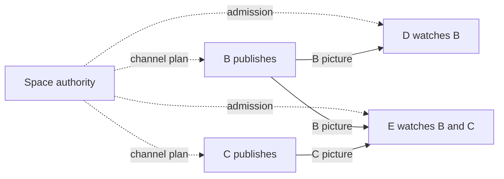

# Piik 3.0 Channel And Network Design

Reviewed 2026-10-26. Proposal for owner discussion, before implementation.
Rust is the selected core language. This document owns the proposed 3.0 model;
the [2.x routing contract](../standards/routing-transport.md) remains unchanged.
The [prototype README](../../prototype/channel-server/README.md) owns what runs
today; [TODO](../todo.md) owns remaining work.

## Recommendation

Use one service authority for a space containing channels. Separate management,
membership, publishing, watching and forwarding. Within each channel, one route
coordinator owns all publications and subscriptions; each publication has its own
distribution tree, and compatible flows reuse physical peer connections. Each
media runtime admits its aggregate work across channels and service connections.

An App can host a temporary space; a self-hosted Server can keep a space available.
Both use the same Rust core and Web UI. The service owns metadata and permissions;
ordinary media remains P2P-first with bounded peer forwarding and an optional SFU.
Participants can publish without becoming the space administrator.

## Lessons From Mature Systems

| Evidence | Application to Piik |
| --- | --- |
| Discord separates a [guild and its channels](https://github.com/discord/discord-api-docs/blob/main/developers/resources/guild.mdx) from [voice connections](https://github.com/discord/discord-api-docs/blob/main/developers/topics/voice-connections.mdx). | Space membership survives a call ending. A media transport failure does not erase chat or channel membership. |
| Discord supports [text in voice channels](https://discord.com/blog/text-in-voice-chat-channel-announcement-tiv), including reading without joining the call. | A Piik channel can contain conversation and optional media. Browsing is independent of joining voice. |
| Discord's [multistream presentation](https://support.discord.com/hc/en-us/articles/360045784891-Video-Screenshare-Updates-Multistream-and-More) distinguishes multiple pictures and a focused picture; LiveKit exposes [selective subscriptions](https://docs.livekit.io/transport/media/subscribe/#selective-subscription). | A publication is available before anybody watches it. A multi-picture view selects subscriptions; focus selects presentation and requested representation. |
| Discord's [permission model](https://github.com/discord/discord-api-docs/blob/main/developers/topics/permissions.mdx) distinguishes channel visibility, connection and publishing. | Keep those authority boundaries, with a small member/admin policy. Piik does not need the full role and category-overwrite hierarchy. |
| Mumble distinguishes registered identity from live session and has separate [Enter, Listen and Speak permissions](https://github.com/mumble-voip/mumble/blob/master/src/ACL.h). | A new WebSocket is not a new person; receiving voice need not require microphone access. |
| [Spacebar](https://docs.spacebar.chat/setup/server/installation/generic/voice/) separates service and media responsibilities. Discord's [voice architecture article](https://discord.com/blog/how-discord-handles-two-and-half-million-concurrent-voice-users-using-webrtc) describes server-mediated media. | These inform responsibility boundaries. Their central media topology is not evidence for Piik's peer-forwarding design. |

These are design inputs. The proposed Piik topology below is our choice, derived
from the current controller and the multiple-publisher requirement.

## Objects And Their Owners

| Object | Owner and lifetime |
| --- | --- |
| Service instance | Rust process and storage adapter. A process restart creates a new live incarnation, even when durable space identity survives. |
| Space | Service authority owns its channel catalog, membership and policy. A temporary App space ends when its hosting service ends; a Server space survives administrator logout and service restart. |
| Category | Space-owned display grouping. Moving a channel between categories does not change access or interrupt media. |
| Channel | Authority owns conversation and media scope. Deletion retires that channel's resources; an empty channel remains available. |
| Member | Space-scoped authenticated principal, separate from nickname and connection identity. Credentials or invitations establish access; no global account service is required. |
| Session | Authority owns a live participant endpoint and its reconnect window. Same-session reconnect does not create another member or duplicate publications. |
| Capture | Browser or Native adapter owns OS permission and source resources. Route repair reuses capture; it does not reacquire the screen or microphone. |
| Publication | Publisher session owns a channel-scoped microphone or picture source, authorized by the service. Picture and its source sound stay together; room voice is a separate publication. |
| Subscription | Receiver requests an authorized publication. Unsubscribe, source retirement or access loss ends it, without affecting other subscriptions. |
| Transport | Media runtime owns a physical peer connection shared by its admitted flows. Removing one flow closes the transport only when no flow still uses it. |
| Attachment / transfer | Message metadata and available content belong to the attachment; a separate finite transfer owns each recipient's progress and cancellation. |

Selected channel, drafts, collapsed categories and focused picture are local UI
state. They are not media authority. Browser and linked App are backends for the
same participation, rather than two people in the participant list. Separate
devices remain distinct live endpoints even when the same member uses both.

The initial service hosts one space with multiple channels. Users join other
independently hosted spaces directly. Cross-service federation, replicated room
authority and automatic replacement of a departed App host are outside this
baseline. [XMPP MUC](https://xmpp.org/extensions/xep-0045.html) and
[Matrix's replicated rooms](https://spec.matrix.org/latest/#architecture) show why
independent hosting and federation are different commitments.

An invitation admits a member; it is not that member's identity. Independent
people redeeming the same invitation receive different member credentials, even
with identical nicknames. Reconnect proves the member credential and live session.
Revoking an invitation stops new admission; removing a member ends that member's
access. Server membership survives restart until revoked; temporary space
membership ends with its space. These credentials remain scoped to their service.

Recommend allowing a member's distinct devices/tabs without silently taking over
an existing call. Media starts only through an explicit action on that endpoint.
The roster groups activity under the member; controls identify which endpoint
they affect. Endpoint limits still count actual active sessions and media work.

## Interaction And Lifecycle

Recommend one active media channel per endpoint in the first UI, with independent
voice participation, microphone, picture publication and picture subscriptions
inside it. Reading another channel never moves them. This is a UI scope choice
for discussion: the current local prototype permits voice and picture in different
channels. Publication and subscription records always carry their own channel;
the wire model does not encode a permanent one-channel limitation.

The active media channel is derived from active participation; it is not another
room or connection state machine. Starting a picture does not require joining
voice. Joining voice can be listen-only. Microphone mute preserves participation,
and headphone mute changes local listening. Voice is available according to channel
policy rather than an administrator's microphone lifetime. No active media demand
means no media connections, encoders or decoders.

| User action or event | Result |
| --- | --- |
| Read another channel | Show its conversation; keep current media and a compact control strip identifying its channel. |
| Explicitly change media channel | First admit the destination; failure keeps the current context. On commit, leave old-channel voice, stop its picture publication and unsubscribe its pictures. Reuse the permitted microphone and mute setting if continuing voice. Sharing a picture in the destination requires an explicit action and new publication authority. |
| Stop a picture / leave voice | Retire only that activity. Chat, other members' pictures and independent activities continue. |
| Watch several pictures | Subscribe to selected publications and render them in one grid. Focus one picture for a larger view; use existing media adaptation for representations. |
| Switch a picture source | Keep the publication identity with a new source generation; retire old generation input grants and media callbacks. Current authorized subscribers follow the replacement. |
| Publisher or relay disconnects | Recover only affected source paths. Healthy publications and chat continue. |
| Signaling connection drops | Keep committed media within the session's existing reconnect window; freeze new authority-changing work. Reauthenticate and reconcile with the authority snapshot. |
| Session expires or access is revoked | Stop its authorized distribution and input, release its reservations and remove presence. Reconnecting cannot revive revoked grants. |
| Service process restarts | Restore durable catalog/history where configured, create new live sessions and readmit media. Old transport/control grants cannot authorize the new incarnation. |
| Close a page / quit an App | Retire resources owned by that runtime. A Native background sharing session continues only under its existing explicit background owner; linking an App alone does not transfer Browser capture ownership. |
| Administrator leaves | A Server space and its participants continue. Quitting the App that hosts a temporary space ends its authority regardless of who is administrator. |

Start with the current 20-second signaling recovery policy for the experiment;
the session owner starts one bounded recovery interval on loss of its authority
connection. Every runtime, including publishers and relays, enforces that deadline
on its local authorized flows and input. Failed socket replacements cannot extend
it; successful reauthentication reconciles current authority. Do not add another
publication heartbeat. Explicit local stop/revoke takes effect immediately;
unreachable participants stop at their session deadline when revocation cannot
reach them. Deleting server-side presence alone does not stop a P2P sender.

Remote input is authorized by the source owner and local controlled device.
Space administration does not grant desktop control. Grants name the publication,
source generation and controller session. Focus changes do not silently retarget
input; recovery releases pressed inputs before an authorized route resumes.

Presence, voice participation, source readiness and transport readiness remain
different facts. The UI projects them from their owners: signaling can be healthy
while one picture is reconnecting, and a quiet channel is not a failed network.

## Network Model

### Compare The Alternatives

| Model | Benefit | Cost and decision |
| --- | --- | --- |
| One shared bidirectional tree | Simple unique paths; closest to current voice projection. | Different publishers and selective viewers can force unnecessary forwarding through common cuts. Keep as a comparison baseline. |
| One distribution tree per publication, one channel coordinator | Paths follow actual recipients; existing transports can carry several sources. | Requires shared capacity admission and per-publication parent identity. Recommended. |
| Several simultaneous paths for the same publication | Could distribute one source over multiple paths. | Adds duplicate suppression, ordering and repair ownership. Not needed for this baseline. |

Today, [`projectVoiceFlows`](../../internal/server/signal/voice_plan.go) already
projects individual voice publications over the unique paths of a common room
tree. It does not broadcast every source over every edge.
[`voiceSourceUsable`](../../internal/server/route/voice.go) still requires the path
to lead to the listening Host or its admitted SFU junction. These are concrete
reuse and replacement boundaries, not a finished multi-source router.

Consider five endpoints: A hosts the authority and can relay, B and C each publish
4 Mbps, D watches B, and E watches both B and C. A shared tree has edges A-B, A-C,
B-D and C-E. Count media payload here, excluding protocol and retransmission cost.

| Arrangement | Outbound media per sender | Total across these hops |
| --- | --- | --- |
| Shared tree | B: 8 Mbps; A: 4 Mbps; C: 8 Mbps | 20 Mbps |
| Direct trees when B-D, B-E and C-E work | B: 8 Mbps; C: 4 Mbps; A: 0 Mbps | 12 Mbps |

In the shared tree, B's picture travels B-D and B-A-C-E. C's picture only travels
C-E. The arithmetic illustrates a possible detour, not a measured performance
gain: blocked direct paths or endpoint limits can require different routes.
Most importantly, C has one child but sends it two pictures.

### Preserve The Controller, Generalize Its Subject

One channel coordinator owns the committed plan and one bounded route transition
at a time. The plan contains all publication trees. No publication, voice adapter,
SFU client or UI starts a competing optimizer. Different channels may proceed
independently, subject to actual endpoint reservations.

Group flows sharing the same physical preparation into one transition; do not
spend a separate connection timeout on every publication. Availability repair
takes priority over optional route improvement. The coordinator serializes plan
changes, while media I/O and unaffected activities continue asynchronously.

Each receiver has one committed input per publication. That publication's
forwarding edges are acyclic. The combined physical graph can contain cycles or
opposite flows belonging to different publications. Preserve the single owner,
serial operation, bounded opportunity and rollback model of
[ADR-0005](../adr/0005-automatic-hybrid-media-routing.md); replace its single Host
source and single upstream per Viewer in a new decision after owner agreement.

Reuse peer connections only within compatible authority/session boundaries.
Every carried flow identifies its publication and generation. One connection
failure can affect several flows, but retiring one source cannot tear down the
other flows. A replacement transition owns only its reservations; an old callback
cannot release the new generation's resources.

The runtime is the sole physical transport owner and serializes its negotiation,
ICE recovery and close operations. Channel coordinators submit flow requests;
they cannot independently mutate a shared PeerConnection. Capacity is returned
when the corresponding physical work has retired, not merely when a map entry
has been removed. This transport execution queue is not another route planner.

Keep demand-driven P2P attempts, mature ICE/STUN handling, sticky healthy routes,
bounded retries and SFU fallback. Reuse an eligible connected peer before creating
unnecessary connections. Candidates must already have or be assigned an admitted
source path; reject a same-publication cycle before preparation. Do not add full
mesh discovery, all-pairs probes, periodic balancing or custom quality scores.

Prepare a replacement, prove media usable, commit, then release the old flow.
Picture needs a decoded frame; silent or muted voice must not wait for audible
speech as proof. Voice readiness combines negotiated transport and installed
publication forwarding. When overlap has no capacity, the same operation chooses
a bounded interruption instead. WebRTC owns congestion adaptation, ICE recovery
and transport feedback; the route coordinator owns which permitted path is used.

Voice uses the same publication/subscription mechanism. Joining voice expresses
subscriptions to the other joined speakers, without receiving one's own audio.
Voice forwarding uses joined, authorized participants. Picture forwarding uses
authorized participants with relay capability and available resources. A relay's
local mute or hidden player does not discard media that its downstream still needs.

Peer relays and SFU terminate their media hops. SRTP protects those hops; this
proposal does not introduce end-to-end encryption against a forwarding endpoint.
Private-channel media and metadata must never be offered to an unauthorized relay.

### Count Actual Work

Child count alone cannot admit multi-source forwarding. Account for connections,
outbound publication/representation copies, active encoders/decoders and admitted
transition overlap. Outbound rate includes every copy, whichever direction it
travels in the logical tree, plus protocol overhead and retransmission.

The channel coordinator requests work; the Browser or App media runtime atomically
reserves and accepts or rejects it. Its one resource owner covers all work it
actually hosts. An App serving several authorized sites shares that native budget;
a Browser page owns its own runtime, not the physical computer's entire uplink.
Do not claim that independent browser origins or unrelated services know each
other's traffic. Existing configured limits and measured transport information
guide admission; mature senders still handle changing available bandwidth.

Reuse compatible source encodings rather than re-encode once per recipient.
Browser relay can still involve decoding and encoding; it is not a transparent
packet switch. [RFC 8834 section 4.4](https://www.rfc-editor.org/rfc/rfc8834.html#section-4.4)
also requires appropriate clock and congestion handling across peer sessions.
Keep outbound transport feedback and shared transport budgets with the media
implementation. Do not take the slowest subscription's requested quality and
apply it as a cap on the entire source. Preserve unaffected outputs; common uplink
bottlenecks, relay ingress or limited encoders can still require related
subscriptions to reduce quality, pause or be refused.

SFU fallback enters the same plan and admission accounting. Count each ingested
publication/representation and each outgoing copy. A configured SFU URL is not
evidence of reachable media. If a path is unavailable, report the affected
subscription and preserve working paths.

## Access, History And Files

Begin with space administrator/member roles and channel membership. Categories
only organize display. The authority derives visibility, message sending,
media receive/publish and management capabilities from that policy. Filter channel
metadata, history, presence and publication events before sending them. Media
authorization names the source, recipient/relay, channel and current session.

Chat messages have server-attributed authors, stable message IDs and channel
identity. A client nonce makes a retry of the same send idempotent. Reconnect
takes an authorized snapshot with a revision and subsequent events; no unbounded
event replay system is needed. Server history has configured retention; the
temporary App space can use bounded in-memory history. Drafts remain local.

Files remain in scope for discussion. Use one attachment model with explicit
availability, and a separate transfer for each receiver:

| Hosting | Content availability and transfer |
| --- | --- |
| Temporary App space | Sender offers online content. Transfer directly to the requesting recipient over a reliable, authorized data path. Sender departure marks the offer unavailable. |
| Persistent Server space | Upload to temporary storage, validate and commit, then publish the attachment. Authorized HTTP download remains available according to storage retention. |

The [LocalSend protocol](https://github.com/localsend/protocol) is a useful
prepare/accept/transfer/cancel reference. Discord's
[attachment metadata](https://github.com/discord/discord-api-docs/blob/main/developers/resources/message.mdx)
separates the message reference from expiring download URLs. Piik can initially
check current access on each Server download instead of adding signed URLs.

File bytes do not travel through the signaling WebSocket, remote-input queue or
ordinary media-forwarding tree. Reuse an eligible direct peer transport where
available; new transfer-only connections count against the same endpoint budget.
Chunk against negotiated message limits and apply queue backpressure. Separate
DataChannels still share SCTP congestion ([RFC 8831](https://www.rfc-editor.org/rfc/rfc8831.html));
they do not give bulk transfers an independent network budget. Bound concurrent
transfers and queued bytes, keep media responsive, and avoid inventing another
congestion controller.

Large Browser downloads require a supported streaming sink. Otherwise expose a
bounded file-size capability or an App receiver, not an unlimited in-memory Blob.
Browsing channels does not cancel an accepted transfer. Cancellation, access loss,
content deletion or receiver shutdown does; the same transfer owner also stops an
in-progress HTTP response on access loss. Online offers additionally depend on
their source owner's lifetime and session deadline. A transient WebSocket loss
does not retire the offer; a failed transfer may be retried once its path returns.
An uploaded, committed Server attachment does not depend on its uploader remaining
online. Partial local files are cleaned by their transfer owner. Already downloaded
files cannot be remotely revoked.

## Rust Implementation Boundaries

| Layer | Proposed responsibility and reuse |
| --- | --- |
| Shared Rust core | Membership, channel policy, conversation, publication/subscription state and route coordination. App and Server use the same owners. |
| Axum/Tokio boundary | HTTP/WebSocket, timers and I/O. Validate external input once and pass typed commands into the core; do not keep a second copy of business state in handlers. |
| Web interface | Reuse the current React controls, Browser capture, playback and native `RTCPeerConnection`. Channel selection and media projections consume authoritative state. |
| Native adapters | Reuse platform capture/encoding/input helpers. Rust owns their session and resource lifetime through narrow typed interfaces. Rust core does not require rewriting platform code or codecs. |
| Native media and embedded SFU | Evaluate an established WebRTC implementation for codec interoperability, bandwidth control, forwarding, ICE and source replacement before replacing the current media core. |
| Storage | One explicit owner for durable Server catalog/history/attachments; temporary App spaces need no new configuration migration scheme. |

[str0m](https://github.com/algesten/str0m) and
[webrtc-rs](https://github.com/webrtc-rs/webrtc) are candidates, not selected
replacements. The [LiveKit Rust SDK](https://github.com/livekit/rust-sdks) provides
client and service APIs; it does not supply a Rust SFU. Compare actual native
capture and relay paths before choosing. Target one shared Rust core with thin
App/Server wrappers. Adding a Go media worker would add IPC, supervision and
packaging obligations, so it is a separate tradeoff requiring owner discussion.

3.0 defines a new public major contract rather than supporting two business
models inside every module. Keep 2.x on its existing line while experimenting;
specify the new Browser/App handshake and durable-data upgrade path before
cutover. Optional capabilities support additive later features. Product version,
wire version, stored schema and live generation keep their separate jobs under
the [versioning standard](../standards/versioning.md).

## Implementation Order After Discussion

1. Replace connection-only prototype identity with actual membership and sessions.
   Add authorized channel snapshots and independent activity state in the Rust core.
   In parallel, prove that candidate Rust media components can accept existing
   Native encoded frames and forward to a Browser with feedback and clean retirement.
   Resolve that boundary before committing the transport interface.
2. Complete a Browser vertical slice: A hosts, B publishes, C watches and speaks;
   A need not publish. Browsing, mute, stop and reconnect exercise the real owners.
3. Extend the same planner to two simultaneous sources and selective multi-view;
   compare shared-tree and per-publication routing under the same constrained
   endpoints. Exercise relay exit and recovery without disturbing healthy sources.
4. Admit Native and SFU backends through the chosen media implementation. Verify
   aggregate capacity, source replacement, authorization and transport retirement.
5. Add the agreed attachment scope and finish the shared channel controls and
   diagnostics. Native and Browser controls use capabilities, not platform forks.

The usable network baseline is five endpoints, two independent publishers,
selective watching, simultaneous voice and bounded peer forwarding, with observed
recovery on relay exit. Its acceptance includes session reconnect, revocation,
source replacement and cleanup without killing unrelated activities. The current
chat/local-capture prototype is the starting point, not that delivered baseline.

## Decisions For Owner Discussion

- **Network:** recommend per-publication trees inside one channel coordinator,
  retaining shared admission and operation ownership. This deliberately replaces
  the old single-publisher, single-parent constraint.
- **First UI scope:** recommend one active media channel per endpoint, with free
  browsing and multiple pictures inside it. If simultaneous voice in A and sharing
  in B is required immediately, expose those destinations explicitly; the proposed
  identities and runtime budget already support that extension.
- **Persistence:** recommend temporary App spaces and durable Server spaces.
  Begin file exchange with online offers for App spaces and stored attachments
  for configured Servers; do not add federation or automatic host takeover.
