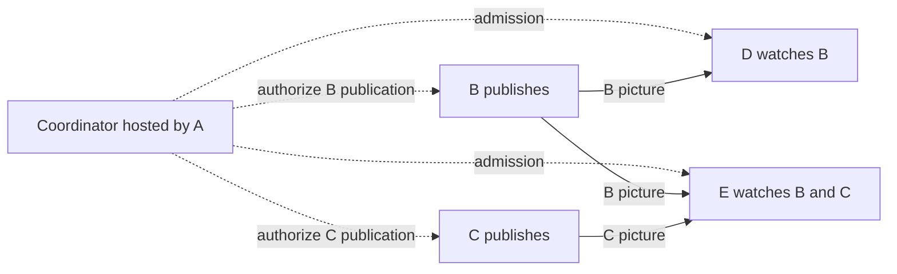

# Piik 3.0 Channels, Rooms And Networking

Reviewed 2026-10-27. The owner authorized the usable Browser prototype after
agreeing the vocabulary and independent activity model. Rust is the selected core
language. This document owns the 3.0 model and subsequent design proposals;
the [2.x routing contract](../standards/routing-transport.md) remains unchanged.
The [prototype README](../../prototype/channel-server/README.md) owns what runs
today; [TODO](../todo.md) owns remaining work.

## Terminology And Roles

The owner established this vocabulary on 2026-10-27. It applies to 3.0 discussion
and design; published 2.x Host/Viewer terminology keeps its existing scope.

| English | Chinese | Meaning |
| --- | --- | --- |
| User | 用户 | Every participant, including domain owners, room owners and anyone sharing, watching or forwarding. |
| Channel | 频道 | The top-level container for users, roles and rooms. |
| Room | 房间 | A conversation and media scope inside a channel. |
| Domain owner | 域主 | The user who creates and owns the channel, managing its users, roles and rooms. |
| Room owner | 房主 | The user who creates and manages a room inside the channel. |
| Role | 身份组 | A channel-scoped permission group. A user can belong to several roles at once. |
| Sharer | 分享者 | A user originating a media publication, rather than merely initiating a peer connection. |
| Coordinator | 协调服务 | The process enforcing channel policy and maintaining its directory; it is not the domain owner as a person. |

Domain owners and room owners remain users; neither management identity depends
on being a sharer. Identity, permission and activity are independent. Roles
describe what a user may do; sharing, watching, speaking and forwarding describe current activity. One
user can publish a picture, watch another user's picture and forward that received
publication at the same time. Permission and actual resources govern each flow;
there is no exclusive `owner | sharer | viewer | relay` user type.

A denotes the domain owner in examples. References to A's processing or traffic
mean the coordinator hosted on A's device. A Server can host that coordinator
independently of the owner's personal endpoint. Leaving as a user and stopping
the coordination process are distinct lifecycle events.

## Recommendation

Use one service authority for a channel containing rooms. Separate management,
membership, publishing, watching and forwarding. Rooms own access and their
publication directory. Each publication owns its distribution plan and recovery;
different publications and rooms can progress independently. Compatible flows
reuse physical peer connections. Each media runtime accounts for the actual work
it hosts across those flows. The channel has no fixed media allowance to divide
among its rooms or users.

An App can host a temporary channel; a self-hosted Server can keep a channel available.
Both use the same Rust core and Web UI. The service owns metadata and permissions;
ordinary media remains P2P-first with bounded peer forwarding and an optional SFU.
Users can publish without becoming the domain owner or room owner.

The baseline aims for anyone to host a channel without a mandatory Piik-operated
account or coordination service, with media work distributed among participants.
Each channel retains one coordination authority. Further decentralization is now
being researched in the [assessment below](#further-decentralization-assessment).
Sharer-side route computation is the first proposed comparison; replicated
authority and automatic takeover remain separate choices. This assessment does
not silently replace the baseline or authorize its implementation.

## Lessons From Mature Systems

| Evidence | Application to Piik |
| --- | --- |
| Discord separates a [guild and its channels](https://github.com/discord/discord-api-docs/blob/main/developers/resources/guild.mdx) from [voice connections](https://github.com/discord/discord-api-docs/blob/main/developers/topics/voice-connections.mdx). | Channel membership survives a call ending. A media transport failure does not erase chat or room membership. |
| Discord supports [text in voice channels](https://discord.com/blog/text-in-voice-chat-channel-announcement-tiv), including reading without joining the call. | A Piik room can contain conversation and optional media. Browsing is independent of joining voice. |
| Discord's [multistream presentation](https://support.discord.com/hc/en-us/articles/360045784891-Video-Screenshare-Updates-Multistream-and-More) distinguishes multiple pictures and a focused picture; LiveKit exposes [selective subscriptions](https://docs.livekit.io/transport/media/subscribe/#selective-subscription). | A publication is available before anybody watches it. A multi-picture view selects subscriptions; focus selects presentation and requested representation. |
| Discord's [permission model](https://github.com/discord/discord-api-docs/blob/main/developers/topics/permissions.mdx) assigns multiple roles to users and distinguishes visibility, connection and publishing. | Keep users separate from their role memberships and live activities. Define the necessary channel/room permissions without copying the entire override hierarchy. |
| Mumble distinguishes registered identity from live session and has separate [Enter, Listen and Speak permissions](https://github.com/mumble-voip/mumble/blob/master/src/ACL.h). | A new WebSocket is not a new person; receiving voice need not require microphone access. |
| [Spacebar](https://docs.spacebar.chat/setup/server/installation/generic/voice/) separates service and media responsibilities. Discord's [voice architecture article](https://discord.com/blog/how-discord-handles-two-and-half-million-concurrent-voice-users-using-webrtc) describes server-mediated media. | These inform responsibility boundaries. Their central media topology is not evidence for Piik's peer-forwarding design. |
| mediasoup distinguishes room-like routers, individual producers/consumers, and the workers that supply [actual processing capacity](https://mediasoup.org/documentation/v3/scalability/). Its [transport API](https://mediasoup.org/documentation/v3/mediasoup/api/#Transport) owns connection bitrate limits. | Separate logical conversation, individual media demand and physical capacity. Shared implementation does not require one global scheduling instance or a fixed room-wide bitrate pool. |

These are design inputs. The proposed Piik topology below is our choice, derived
from the current controller and the multiple-source requirement.

## Objects And Their Owners

| Object | Owner and lifetime |
| --- | --- |
| Service instance | Rust process and storage adapter. A process restart creates a new live incarnation, even when durable channel identity survives. |
| Channel | Service authority owns its room catalog, membership, role definitions and user-role assignments. A temporary App channel ends when its hosting service ends; a Server channel survives the domain owner's logout and service restart. |
| Category | Channel-owned display grouping. Moving a room between categories does not change access or interrupt media. |
| Room | Authority owns conversation and media scope. Deletion retires that room's resources; an empty room remains available. |
| User | Channel-scoped authenticated principal, separate from nickname and connection identity. Credentials or invitations establish access; no global account service is required. |
| Session | Authority owns a live participant endpoint and its reconnect window. Same-session reconnect does not create another user or duplicate publications. |
| Capture | Browser or Native adapter owns OS permission and source resources. Route repair reuses capture; it does not reacquire the screen or microphone. |
| Publication | The sharer's session owns a room-scoped microphone or picture source, authorized by the service. Picture and its source sound stay together; room voice is a separate publication. |
| Subscription | Receiver requests an authorized publication. Unsubscribe, source retirement or access loss ends it, without affecting other subscriptions. |
| Transport | Media runtime owns a physical peer connection shared by its admitted flows. Removing one flow closes the transport only when no flow still uses it. |
| Attachment / transfer | Message metadata and available content belong to the attachment; a separate finite transfer owns each recipient's progress and cancellation. |

UI preferences belong to the client. Selected room, drafts, collapsed categories
and focused picture are local UI state. They are not media authority. Browser and
linked App are backends for the same participation, rather than two people in the participant list. Separate
devices remain distinct live endpoints even when the same user uses both.

The initial service hosts one channel with multiple rooms. Users join other
independently hosted channels directly. Cross-service federation, replicated channel
authority and automatic replacement of a departed App host are outside this
baseline. [XMPP MUC](https://xmpp.org/extensions/xep-0045.html) and
[Matrix's replicated rooms](https://spec.matrix.org/latest/#architecture) show why
independent hosting and federation are different commitments.

An invitation admits a user; it is not that user's identity. Independent
people redeeming the same invitation receive different user credentials, even
with identical nicknames. Reconnect proves the user credential and live session.
Revoking an invitation stops new admission; removing a user ends that user's
access. Server membership survives restart until revoked; temporary channel
membership ends with its channel. These credentials remain scoped to their service.

The current room-access experiment uses two policies. Public rooms admit every
channel user; private rooms admit their room owner, the domain owner and explicitly
granted users. Ordinary members may create and manage their own rooms. Moderator
membership alone does not grant private-room reading or management. Hidden is a
private-room directory setting: unauthorized users receive neither its directory
entry nor its history, publications, voice or routes. Public rooms normalize
hidden to false. A peer without room access cannot relay that room's media.

A private-room invitation can admit a new channel user and grant that room in
one operation. A room password grants an existing channel user entry. Successful
entry records a user grant; rotating or removing the password/invitation affects
new admission, while existing grants require explicit revocation. Revoking a
grant alone is not a ban on redeeming a still-valid admission secret. Public to
private preserves explicit grants and access for the room and domain owners, without converting
past public visitors into private members. Revocation retires only that room's
activities; unrelated flows sharing a physical pair continue.

The hosting coordinator owns authoritative saved data, on the local device or
configured server running it. The checkpoint contains channel identity, user
credential digests, room policy, salted password hashes, invitation digests, grants
and bounded message history.
It excludes live sessions, captures, publications and routes. Startup admission
keys remain external configuration. Password hashing uses the maintained
[RustCrypto Argon2 implementation](https://docs.rs/argon2/0.5.3/argon2/).
Room privacy borrows the separation between visibility and access from
[mature permission models](https://github.com/discord/discord-api-docs/blob/main/developers/topics/permissions.mdx),
without importing a permission-override matrix.

Recommend allowing a user's distinct devices/tabs without silently taking over
an existing call. Media starts only through an explicit action on that endpoint.
The roster groups activity under the user; controls identify which endpoint
they affect. Endpoint limits still count actual active sessions and media work.

## Interaction And Lifecycle

Allow explicit participation and watching across rooms. Each activity names
its room; browsing or joining another room does not move existing activity.
Watching more pictures increases receiving and decoding work. This is expected
usage, not a reason to impose a one-room restriction. Microphone destinations
remain explicit: browsing or listening to a room does not broadcast into it.

There is no single active-media-room field controlling all resources. Starting
a picture does not require joining voice. Joining voice can be listen-only.
Microphone mute preserves participation, and headphone mute changes local
listening. Controls identify the activity and room they affect. Voice is
available according to room policy rather than the domain owner's microphone
lifetime. No active media demand means no media connections, encoders or decoders.

| User action or event | Result |
| --- | --- |
| Read another room | Show its conversation; keep current media and controls identifying their activity and room. |
| Join or watch in another room | Authorize and add that participation or subscription. Existing rooms continue; additional media adds actual resource demand. |
| Explicitly move an activity | First admit its destination; failure keeps the original activity. Commit replaces only that activity's room authorization. Reuse a permitted microphone and its mute setting; sharing a picture to a new audience requires an explicit destination choice. Other activities remain where they are. |
| Stop a picture / leave voice | Retire only that activity. Chat, other users' pictures and independent receiving/forwarding activities continue. |
| Watch several pictures | Subscribe to selected publications and render them in one grid. Focus one picture for a larger view; use existing media adaptation for representations. |
| Switch a picture source | Keep the publication identity with a new source generation; retire old generation input grants and media callbacks. Current authorized subscribers follow the replacement. |
| Sharer or relay disconnects | Recover only affected source paths. Healthy publications and chat continue. |
| Signaling connection drops | Keep committed media within the session's existing reconnect window; freeze new authority-changing work. Reauthenticate and reconcile with the authority snapshot. |
| Session expires or channel membership is revoked | Retire work and presence authorized by that session or membership. Other authorized sessions and channels retain their own lifetimes. Reconnecting cannot revive revoked grants. |
| Room access or role assignments change | Recompute effective permissions and retire only affected activities or room presence. Losing publishing permission does not end permitted viewing or forwarding; removing one role does not end work still permitted by the resulting policy. |
| Service process restarts | Restore durable catalog/history where configured, create new live sessions and readmit media. Old transport/control grants cannot authorize the new incarnation. |
| Close a page / quit an App | Retire resources owned by that runtime. A Native background sharing session continues only under its existing explicit background owner; linking an App alone does not transfer Browser capture ownership. |
| Domain owner leaves | A Server channel and its users continue. Quitting the App that hosts a temporary channel ends its authority; ownership alone does not require the owner's personal endpoint to remain. |

Start with the current 20-second signaling recovery policy for the experiment;
the session owner starts one bounded recovery interval on loss of its authority
connection. Every runtime, including sharers and relays, enforces that deadline
on its local authorized flows and input. Failed socket replacements cannot extend
it; successful reauthentication reconciles current authority. Do not add another
publication heartbeat. Explicit local stop/revoke takes effect immediately;
unreachable participants stop at their session deadline when revocation cannot
reach them. Deleting server-side presence alone does not stop a P2P sender.

Remote input is authorized by the source owner and local controlled device.
Domain ownership and administrative roles do not grant desktop control. Grants
name the publication, source generation and controller session. Focus changes do not silently retarget
input; recovery releases pressed inputs before an authorized route resumes.

Presence, voice participation, source readiness and transport readiness remain
different facts. The UI projects them from their owners: signaling can be healthy
while one picture is reconnecting, and a quiet room is not a failed network.

## Network Model

### Compare The Alternatives

| Model | Benefit | Cost and decision |
| --- | --- | --- |
| One shared bidirectional tree | Simple unique paths; closest to current voice projection. | Different sharers and selective viewers can force unnecessary forwarding through common cuts. Keep as a comparison baseline. |
| One distribution plan per publication | Paths and recovery follow actual recipients; independent publications progress concurrently and reuse eligible transports. | Requires per-publication route ownership and admission at the actual shared resource. Recommended. |
| Several simultaneous paths for the same publication | Could distribute one source over multiple paths. | Adds duplicate suppression, ordering and repair ownership. Not needed for this baseline. |

Today, [`projectVoiceFlows`](../../internal/server/signal/voice_plan.go) already
projects individual voice publications over the unique paths of a common room
tree. It does not broadcast every source over every edge.
[`voiceSourceUsable`](../../internal/server/route/voice.go) still requires the path
to lead to the listening Host or its admitted SFU junction. These are concrete
reuse and replacement boundaries, not a finished multi-source router.

Consider five endpoints: domain owner A hosts the coordinator and can relay;
B and C each publish 4 Mbps, D watches B, and E watches both B and C.
A shared tree has edges A-B, A-C,
B-D and C-E. Count media payload here, excluding protocol and retransmission cost.

| Arrangement | Outbound media per sender | Total across these hops |
| --- | --- | --- |
| Shared tree | B: 8 Mbps; A: 4 Mbps; C: 8 Mbps | 20 Mbps |
| Direct trees when B-D, B-E and C-E work | B: 8 Mbps; C: 4 Mbps; A: 0 Mbps | 12 Mbps |

In the shared tree, B's picture travels B-D and B-A-C-E. C's picture only travels
C-E. The arithmetic illustrates a possible detour, not a measured performance
gain: blocked direct paths or endpoint limits can require different routes.
Most importantly, C has one child but sends it two pictures.

### Put Scheduling At The Activity That Changes

Reuse one route-controller implementation, with state and operations scoped to
each publication. The room owns admission and the publication directory; it
does not impose a queue that makes B's healthy share wait for A's ICE timeout.
Each publication has one owner for its committed distribution plan and bounded
route transitions. Different publications and rooms proceed independently.
Voice, SFU and UI adapters cannot start competing optimizers for the same flow.

Serialize mutations of a publication's own plan and physical operations on the
same transport. Media preparation does not hold a room or channel lock while
waiting for network I/O. Flows using the same physical connection preparation
share that work rather than spending separate ICE timeouts. Availability repair
takes priority over optional improvements within the affected operation owner.

Each receiver has one committed input per publication. That publication's
forwarding edges are acyclic. The combined physical graph can contain cycles or
opposite flows belonging to different publications. Preserve exclusive state
ownership, bounded opportunities and rollback from
[ADR-0005](../adr/0005-automatic-hybrid-media-routing.md). Its single Host source,
single upstream per Viewer and room-wide serial operation are 2.x constraints;
the proposed 3.0 decision replaces them with publication-scoped ownership.

Reuse peer connections only within compatible authority/session boundaries.
Every carried flow identifies its publication and generation. One connection
failure can affect several flows, but retiring one source cannot tear down the
other flows. A replacement transition owns only its reservations; an old callback
cannot release the new generation's resources.

The runtime is the sole physical transport owner and serializes its negotiation,
ICE recovery and close operations. Publication controllers submit flow requests;
they cannot independently mutate a shared PeerConnection. Capacity is returned
when the corresponding physical work has retired, not merely when a map entry
has been removed. This transport execution queue is not another route planner.

Keep demand-driven P2P attempts, mature ICE/STUN handling, sticky healthy routes,
bounded retries and SFU fallback. Reuse an eligible connected peer before creating
unnecessary connections. Candidates must already have or be assigned an admitted
source path; reject a same-publication cycle before preparation. Do not add full
mesh discovery, all-pairs probes, periodic balancing or custom quality scores.

Prepare a replacement, prove media usable, commit, then release the old flow.
Picture needs a decoded frame; silent or muted voice must not wait for audible
speech as proof. Voice readiness combines negotiated transport and installed
publication forwarding. When overlap has no capacity, the same operation chooses
a bounded interruption instead. WebRTC owns congestion adaptation, ICE recovery
and transport feedback; each publication controller owns its permitted paths.

Voice uses the same publication/subscription mechanism. Joining voice expresses
subscriptions to the other joined speakers, without receiving one's own audio.
Voice forwarding uses joined, authorized participants. Picture forwarding uses
authorized participants with relay capability and available resources. A relay's
local mute or hidden player does not discard media that its downstream still needs.

Peer relays and SFU terminate their media hops. SRTP protects those hops; this
proposal does not introduce end-to-end encryption against a forwarding endpoint.
Private-room media and metadata must never be offered to an unauthorized relay.

### Keep The Authority's Work Proportional To Activity

Publication controllers have independent state and operations, but run in the
hosting authority's Rust process in the comparison baseline. This is scheduling
isolation, not distributed computation. The authority still pays for live
sessions, access checks, message delivery, stored history and route-plan changes.

| Work at the authority | Scope |
| --- | --- |
| Connections and heartbeats | One service connection per endpoint can carry multiple room subscriptions; no new signaling socket for every room or picture. |
| Channel directory and presence | Send the authorized summaries needed for navigation. Deliver detailed activity to interested, authorized recipients. |
| Chat and history | Deliver messages to room subscribers; load bounded history for requested rooms instead of every room on each join. |
| Media negotiation and routing | Address negotiation to affected peers and update affected publication plans. Receivers need their assignments, not every source's complete graph. |
| Transport feedback and adaptation | Keep packet feedback, pacing, encoding and decoding at the media endpoints. Supply only the observations required for route decisions to the authority. |

Use an authorized snapshot for initial load or recovery, then scoped changes.
For an event of size B delivered to K recipients, the authority sends roughly
B times K bytes plus transport overhead. If every user's frequent update goes
to every other user, fanout grows quadratically; small messages alone do not
make that design cheap. Room or publication mutations must not hold a global
lock while waiting for network or storage I/O.

The Browser prototype scopes chat and requested history to the browsed room,
negotiation to assigned peer pairs, and route assignments to each endpoint.
Directory and presence changes still use bounded channel snapshots. Production
2.x already reuses encoded room messages and supplies participant-specific routes;
retain those useful boundaries as the prototype grows.

Hosting Web assets causes an initial-download burst. Storing attachments or also
acting as an SFU/peer relay adds real byte delivery and storage work; account for
those roles separately from coordination. A coordinator-only App need not receive
or decode a picture merely to authorize its distribution. The authority's
availability remains central: stopping a temporary hosting App ends the channel's
authority under the existing session deadline. A persistent Server supplies that
availability without requiring the domain owner's personal device to stay online.

### Count Actual Work

Scheduling scope, observed resource use and configured limits have different jobs:

| Scope | Responsibility |
| --- | --- |
| Channel / room | Membership, permissions and publication discovery. Being present does not allocate a share of a fixed media bitrate pool. |
| Publication / subscription | Select, recover and stop that source's delivery; express each receiver's actual demand. |
| Transport / encoder / runtime | Execute and account for real shared work. Coordinate only operations competing for those resources. |
| Optional relay allowance | Bound forwarding undertaken for other people. Do not treat it as a limit on how many pictures the user may watch. |

For example, selecting two 4 Mbps pictures requests about 8 Mbps of media payload
at that receiver, plus overhead, and two decoding paths. A receiver with capacity
can consume both at the requested quality. It does not receive half of an invented
4 Mbps room allowance. Another user who has not subscribed consumes neither
picture merely by joining the channel. A shared relay or SFU counts the copies it
actually sends; additional rooms do not create additional physical uplink.

Child count alone cannot admit multi-source forwarding. Account for connections,
outbound publication/representation copies, active encoders/decoders and admitted
transition overlap. Outbound rate includes every copy, whichever direction it
travels in the logical tree, plus protocol overhead and retransmission.

Publication controllers request work; the Browser or App media runtime accounts
for it and admits finite resources such as encoder slots and relay commitments.
Accounting is not a fixed bandwidth quota or an equal split between rooms.
Watching, publishing and volunteering to relay are distinct user intents; the 2.x
single-picture outbound-copy default is not a universal 3.0 activity limit.
An App serving several sites has one native resource owner. A Browser page owns
its own runtime, not the physical computer's entire uplink. Independent browser
origins and unrelated services do not know each other's traffic. Capability,
explicit resource limits and actual transport feedback govern admission and
adaptation; changing bandwidth remains the mature media implementation's job.

Reuse compatible source encodings rather than re-encode once per recipient.
Browser relay can still involve decoding and encoding; it is not a transparent
packet switch. [RFC 8834 section 4.4](https://www.rfc-editor.org/rfc/rfc8834.html#section-4.4)
also requires appropriate clock and congestion handling across peer sessions.
Keep outbound transport feedback and shared transport budgets with the media
implementation. Do not take the slowest subscription's requested quality and
apply it as a cap on the entire source. Preserve unaffected outputs; common uplink
bottlenecks, relay ingress or limited encoders can still require related
subscriptions to reduce quality, pause or be refused.

SFU fallback enters the affected publication plan and actual resource accounting. Count each ingested
publication/representation and each outgoing copy. A configured SFU URL is not
evidence of reachable media. If a path is unavailable, report the affected
subscription and preserve working paths.

### Further Decentralization Assessment

Separate three decisions: which endpoints maintain connections, how each source
reaches its subscribers, and who may commit membership or permission changes.
A sparse peer graph, one delivery tree per publication and one channel authority
can coexist. The combined graph can look like a mesh while each source still has
one committed input at each receiver. Media need not follow control-message paths.

For 20 endpoints, full interconnection requires 190 links. A connected tree has
19; a symmetric graph with average degree three has 30. These are structural
counts, not a proposed degree limit or a NAT success estimate. Construct links
from actual authorized demand and reachability, not every possible pair.

| Candidate | Work removed from A's coordinator | Remaining responsibility and cost |
| --- | --- | --- |
| Sharer runs its publication controller | Route selection, transition state and source-path recovery CPU | A still owns admission and discovery. If all messages pass through A, its signaling traffic remains. |
| Control messages reuse established peer paths | Some steady-state signaling delivery and event fanout | Requires verifiable origin, bounded forwarding and recovery when the path disappears. A still bootstraps new contacts and commits authority changes. |
| Optional trusted service workers | Assigned file delivery, SFU forwarding or room processing | Clients must reach the worker directly to reduce A's byte load; proxying everything through A does not. Delegation does not grant channel administration. |
| Authority replicas or explicit handoff | Read replicas can serve history; handoff moves future ownership | Replication adds work. Handoff needs state, ownership fencing and a usable entry address; neither automatically distributes writes. |
| Multi-writer channel authority | Different nodes accept local changes during partitions | Adds event authentication, replication and conflict resolution, with a new permission/partition policy. This is a different product commitment. |

The first candidate preserves the existing ownership boundaries while moving
their execution: A owns channel membership, room access and the authorized
publication directory; B owns B's publication plan; C owns C's. Each endpoint's
runtime owns its physical connections and resource commitments. A does not keep
a second writable copy of B's route graph. A permits participation, the sharer
chooses a permitted route, and each endpoint admits the work it will perform.

Keep route computation independent of sockets and timers. The same Rust state
machine can be a Native library or a Browser Wasm module, driven by typed events
and producing transport commands. Axum/Tokio stays outside that core. The
[Rust/Wasm WebRTC example](https://wasm-bindgen.github.io/wasm-bindgen/examples/webrtc_datachannel.html)
demonstrates Browser bindings; Piik still needs to validate its own controller
boundary. Browser lifecycle matters: freezing suspends queued work, while Chrome
normally protects active WebRTC pages from discard except under extreme resource
pressure. Hidden is not frozen. The [page lifecycle guidance](https://developer.chrome.com/docs/web-platform/page-lifecycle-api)
does not establish uninterrupted route scheduling. Compare actual background
sharing and recovery before selecting this placement; do not add a second active
controller at A to conceal a lifecycle regression.

First keep message delivery through A to measure computation separately. A later
comparison can reuse a shared control DataChannel on eligible peer transports:

1. A authorizes the sharer and recipients. Before a peer path exists, A
   delivers the initial contact and negotiation messages to the intended parties.
2. Once connected, source-scoped control messages can use that source's existing
   tree where this saves A traffic. Endpoints verify the original controller and
   current authorization, not just the identity of the forwarding neighbor.
3. A supplies targeted contact again if the path breaks. Both carriers deliver
   the same command to the same controller; they do not create separate route state.

Control messages retain publication, session/generation and operation identity.
Transfer queues are bounded; opening another DataChannel does not create an
independent network budget under [RFC 8831](https://www.rfc-editor.org/rfc/rfc8831.html).
Do not put control into the remote-input queue or broadcast private negotiation
data to the whole channel. No media activity means no standing peer control mesh in
this candidate; quiet chat continues through A. Maintaining an always-on mesh for
chat would introduce a new connection lifetime and needs a separate benefit.

#### What Mature Decentralized Systems Contribute

| Primary evidence | Useful idea and boundary |
| --- | --- |
| [HyParView](https://asc.di.fct.unl.pt/~jleitao/pdf/dsn07-leitao.pdf) maintains small active and passive neighbor views. | Bounded neighbors and spare candidates can aid recovery. Random membership alone does not establish an authenticated, reachable Browser media path. |
| [Plumtree](https://asc.di.fct.unl.pt/~jleitao/pdf/srds07-leitao.pdf) sends broadcast payload along trees and uses other overlay links for repair. | A mesh can support efficient trees. Its reliable message-broadcast mechanism is not an RTP forwarding or congestion-control replacement. |
| [Gossipsub](https://github.com/libp2p/specs/blob/master/pubsub/gossipsub/gossipsub-v1.0.md) uses bounded topic meshes and message deduplication. | Consider dissemination costs; do not import a gossip stack, peer scoring or periodic mesh maintenance for a small channel without measured benefit. |
| [Jami's swarm model](https://docs.jami.net/en_US/developer/jami-concepts/swarm.html) replicates conversations between participant devices. | Device-held identity, discovery and synchronized history show a fuller decentralized alternative; these are additional owners, not a route-controller setting. |
| [Matrix architecture](https://spec.matrix.org/latest/#architecture) replicates room events across homeservers with authorization and state resolution. | Multi-writer authority supports a different partition model. Copying room state alone does not provide its conflict or revocation behavior. |

NAT limits the edges that can be established, not whether the application may use
a mesh. If B cannot reach D directly but both can reach an authorized C, C can
provide a forwarding path subject to real capacity. If no permitted reachable
path crosses the network boundary, a graph algorithm cannot supply one. Native
network APIs offer more choices; Browser connections still use supported WebRTC
and its ICE behavior rather than raw socket listeners.

[libp2p's Browser WebRTC specification](https://github.com/libp2p/specs/blob/master/webrtc/webrtc.md)
first uses an authenticated relayed path to exchange SDP and ICE candidates.
[DCUtR](https://github.com/libp2p/specs/blob/master/relay/DCUtR.md) instead coordinates
Native TCP/QUIC connection upgrades through an existing relay. Both illustrate
using an established path to arrange a better one. Neither removes rendezvous or
guarantees direct reachability. Reuse that principle within Piik's existing
transport policy; do not silently introduce a different fallback protocol.

#### Availability Is A Separate Choice

Sharer delegation leaves the coordinator responsible for membership, permissions
and the directory. Losing that process still invokes the session deadline above;
the domain owner's personal endpoint leaving does not. B's source endpoint
exiting ends B's publication, not C's; no peer takes over a departed live source.

For A to stop hosting the coordinator while the channel continues, another
coordinator needs current state, authority to take over, and a reachable entry.
Distinguish four outcomes: existing
media continues, users reconnect, new invitations open, and history/files remain
available. Moving business state does not move an HTTPS origin, certificate or
public tunnel address. Browser credentials also retain their storage scope.
An explicit planned handoff is the smaller candidate if coordinator shutdown must
preserve the channel; crash survival additionally needs replication and takeover rules.

#### Proposed Comparison

The user-facing flow remains join, share and watch. Decentralization must not add
manual peer selection, relay setup or device-role configuration for normal use.
Its costs belong in the same comparison as coordinator savings:

| Experience | Concrete regression to check | Required behavior |
| --- | --- | --- |
| Background sharing | A Browser-side controller can stop scheduling when its page is suspended, even where an independent Native source remains alive. | Preserve supported background sharing and recovery; choose one controller with the needed lifetime. A hidden page alone does not end sharing. |
| Joining and recovering | Forwarded control adds hops; losing a relay can break media and its control path together. | Use the coordinator directly for bootstrap or a known broken path, without first exhausting another overlay retry sequence. |
| Mobile responsiveness | Extra standing connections, forwarding and controller work consume CPU, uplink and battery. | Reuse demanded transports and respect existing relay/resource admission; do not build an idle full mesh. |
| Playback and voice | Choosing peers only to offload A can introduce detours or contend with healthy flows. | Keep media routes independent of the control overlay and retain healthy paths; compare first frame, delay, quality and recovery under the same workload. |
| Concurrent activities | Treating sharer as an exclusive user type can couple unrelated retirement. | B can share while watching and relaying C. Stopping B's source or losing publishing permission preserves permitted C reception/forwarding and its shared transport. |

After owner agreement, compare the same workload in three configurations:
controllers at A; controllers at sharers with A carrying signaling; then the
latter with control delivery reusing established peer paths. Use five actual
endpoints for the existing multi-source baseline and a controlled 20-endpoint
control workload. Keep each user's sharing, watching and forwarding workload
identical across placements. Exercise joins, relay exit, sharer/page suspension,
reconnect and scoped access removal. Record coordinator and delegated endpoint
CPU and task queue delay, A's signaling bytes, total peer bytes and connections,
connection/recovery time, and concurrent voice/playback performance.

Select the placement that reduces the measured bottleneck without making media
recovery or authorization worse. Native and Browser must both retain a single
controller owner; a Browser lifecycle failure is a design result to resolve,
not permission to add silent dual ownership. No decentralization runtime or
performance improvement has been implemented or measured by this assessment.

## Access, History And Files

Users may hold multiple channel-scoped roles. Domain ownership, room ownership,
role assignments and room access feed one permission evaluator; the result determines visibility,
message sending, media receive/publish and management capabilities. Activity
does not grant permission. Define the required role-combination and room-scope
rules before implementation, rather than copying Discord's full override system.
Categories only organize display. Filter room metadata, history, presence and
publication events before sending them. Media
authorization names the source, recipient/relay, room and current session.

Chat messages have server-attributed authors, stable message IDs and room
identity. A client nonce makes a retry of the same send idempotent. Reconnect
takes an authorized snapshot with a revision and subsequent events; no unbounded
event replay system is needed. Server history has configured retention; the
temporary App channel can use bounded in-memory history. Drafts remain local.

The Server prototype implements uploads and authorized downloads; the App peer
transfer remains proposed. Use one attachment model with explicit availability,
and a separate transfer for each receiver:

| Hosting | Content availability and transfer |
| --- | --- |
| Temporary App channel | Sender offers online content. Transfer directly to the requesting recipient over a reliable, authorized data path. Sender departure marks the offer unavailable. |
| Persistent Server channel | Upload to temporary storage, validate and commit, then publish the attachment. Authorized HTTP download remains available according to storage retention. |

The [LocalSend protocol](https://github.com/localsend/protocol) is a useful
prepare/accept/transfer/cancel reference. Discord's
[attachment metadata](https://github.com/discord/discord-api-docs/blob/main/developers/resources/message.mdx)
separates the message reference from expiring download URLs. Piik can initially
check current access on each Server download instead of adding signed URLs.

File bytes do not travel through the signaling WebSocket, remote-input queue or
ordinary media-forwarding tree. Reuse an eligible direct peer transport where
available; new transfer-only connections count against the same endpoint budget.
Chunk against negotiated message limits and apply queue backpressure. Separate
DataChannels still share SCTP congestion ([RFC 8831](https://www.rfc-editor.org/rfc/rfc8831.html));
they do not give bulk transfers an independent network budget. Bound concurrent
transfers and queued bytes, keep media responsive, and avoid inventing another
congestion controller.

Large Browser downloads require a supported streaming sink. Otherwise expose a
bounded file-size capability or an App receiver, not an unlimited in-memory Blob.
Browsing rooms does not cancel an accepted transfer. Cancellation, access loss,
content deletion or receiver shutdown does; the same transfer owner also stops an
in-progress HTTP response on access loss. Online offers additionally depend on
their source owner's lifetime and session deadline. A transient WebSocket loss
does not retire the offer; a failed transfer may be retried once its path returns.
An uploaded, committed Server attachment does not depend on its uploader remaining
online. Partial local files are cleaned by their transfer owner. Already downloaded
files cannot be remotely revoked.

### Persistence And Discovery Assessment

Reviewed 2026-10-27 after the owner's questions about upgrades, room-owner exit,
peer copies and changing invitation addresses. The following is a proposal;
it does not replace the single-authority baseline above.

Keep management identity, message confirmation and content storage separate.
Leaving a room as a user must not delete its history. Stopping the device hosting
its service affects availability, not the existence of stored data. A room owner
can delegate hosting without transferring ownership.

First change the existing persistence owner to incremental room/message writes.
The prototype currently clones its whole authority and rewrites the full durable
checkpoint for each successful durable command, including each chat message.
Retain commit-before-broadcast behavior while removing this whole-channel write
amplification. This improvement does not require distributed authority.

For peer copies, evaluate this small model before implementing replication:

| Data | Proposed storage and synchronization |
| --- | --- |
| Channel directory, membership and room delegation | Coordinator retains authority; ordinary participants do not receive private-room metadata or credential databases. |
| Room conversation | One logical room service confirms messages in order. Authorized participants cache retained history and fetch missing records; keeping a copy grants no management or write authority. |
| Attachment content | Sender retains its offer; recipients download on demand and may serve verified copies. A room host or Server can retain files within an explicit quota, without making the domain owner store every attachment. |

Use authenticated history records and content hashes, not timestamps or file
modification dates, to reconcile copies. A verifiable room log must bind authors,
room scope, authorization and order. Compare valid committed prefixes within
the same authority generation; reject conflicting history rather than silently
choosing a longer copy. Signatures establish authenticity, not that an offline
peer has seen every later message. Attachment hashes belong in authenticated
message metadata, so a receiver can verify bytes obtained from any holder.

When the confirming service is offline, cached history stays readable and new
sends wait for confirmation. Peer file delivery during that outage needs an
agreed cached-access policy; it cannot enforce revocation it has not received.
Planned hosting handoff is separate from automatic election. If participants must write
independently through partitions, first decide how room membership and revocation
merge. Do not introduce that multi-writer model merely to keep read-only copies.

[Jami's signed conversation history](https://docs.jami.net/en_US/developer/jami-concepts/swarm.html)
and [on-demand file copies](https://jami.net/swarm-file-transfers/) demonstrate
these separate responsibilities. Files with no online holder wait for one;
permanent retention requires a device that actually retains the content.

Normal upgrades should reuse a stable data directory outside the program/update
directory. Export/import is backup and recovery, not an upgrade requirement.
Use a [consistent SQLite snapshot](https://www.sqlite.org/backup.html) for the
current database, including its attachment content. Restore a validated snapshot
with the service stopped and retain the previous database until success. Live
sessions, captures and routes never restore. External startup credentials remain
separate configuration; backup contents must state that boundary. Persistent
App identity and retention would revise the temporary-App baseline and need an
explicit decision before implementation.

The left rail can begin with editable URL bookmarks. A channel's persistent ID
and current address are different facts: changing a URL must not create another
channel's data. However, the current UUID is not a cryptographic identity, and
Browser credentials are stored under the page's origin. A new Quick Tunnel URL
cannot read the old origin's credentials or history. A stable client origin or
App-managed identity is needed for seamless cross-address continuity; a signed
address record alone does not solve Browser storage isolation.

[Quick Tunnels change their hostname on creation](https://developers.cloudflare.com/tunnel/get-started/quick-tunnels/).
A user-owned fixed hostname is the simplest stable entry. For automatic discovery
without a Piik-operated service, evaluate [pkarr's signed records](https://github.com/pubky/pkarr/blob/main/design/relays.md):
the App publishes a domain key's current URL to the public DHT, while Browsers
resolve through HTTPS relays and verify the record. This still depends on reachable
bootstrap/relay infrastructure, record refresh and a stable client entry point.
Publish no invitation secrets or credentials. The discovery key must survive
upgrades and backup/restore. Keep automatic discovery an independent experiment
until its identity and Browser bootstrap flow are accepted.

## Rust Implementation Boundaries

| Layer | Proposed responsibility and reuse |
| --- | --- |
| Shared Rust core | Membership, room policy, conversation, publication/subscription state and route coordination. App and Server use the same owners. |
| Axum/Tokio boundary | HTTP/WebSocket, timers and I/O. Validate external input once and pass typed commands into the core; do not keep a second copy of business state in handlers. |
| Web interface | Reuse the current React controls, Browser capture, playback and native `RTCPeerConnection`. Room selection and media projections consume authoritative state. |
| Native adapters | Reuse platform capture/encoding/input helpers. Rust owns their session and resource lifetime through narrow typed interfaces. Rust core does not require rewriting platform code or codecs. |
| Native media and embedded SFU | Evaluate an established WebRTC implementation for codec interoperability, bandwidth control, forwarding, ICE and source replacement before replacing the current media core. |
| Storage | One explicit owner for durable Server catalog/history/attachments; temporary App channels need no new configuration migration scheme. |

[str0m](https://github.com/algesten/str0m) and
[webrtc-rs](https://github.com/webrtc-rs/webrtc) are candidates, not selected
replacements. The [LiveKit Rust SDK](https://github.com/livekit/rust-sdks) provides
client and service APIs; it does not supply a Rust SFU. Compare actual native
capture and relay paths before choosing. Target one shared Rust core with thin
App/Server wrappers. Adding a Go media worker would add IPC, supervision and
packaging obligations, so it is a separate tradeoff requiring owner discussion.

3.0 defines a new public major contract rather than supporting two business
models inside every module. Keep 2.x on its existing line while experimenting;
specify the new Browser/App handshake and durable-data upgrade path before
cutover. Optional capabilities support additive later features. Product version,
wire version, stored schema and live generation keep their separate jobs under
the [versioning standard](../standards/versioning.md).

## Implementation Order

1. Replace connection-only prototype identity with actual membership and sessions.
   Add authorized room snapshots and independent activity state in the Rust core.
   Measure authority CPU, memory, queued bytes and signaling traffic for idle
   users, simultaneous joins, active rooms and reconnection; verify that
   unrelated rooms do not receive detailed media updates or full histories.
   In parallel, prove that candidate Rust media components can accept existing
   Native encoded frames and forward to a Browser with feedback and clean retirement.
   Resolve that boundary before committing the transport interface.
2. Complete a Browser vertical slice: A hosts, B publishes, C watches and speaks;
   A need not publish. Browsing, mute, stop and reconnect exercise the real owners.
3. Run independent instances of the shared planner for simultaneous sources and selective multi-view;
   compare shared-tree and per-publication routing under the same constrained
   endpoints. Exercise relay exit and a stalled source while another source starts,
   across both one room and different rooms. Healthy sources must continue.
4. Admit Native and SFU backends through the chosen media implementation. Verify
   aggregate capacity, source replacement, authorization and transport retirement.
5. Add the agreed attachment scope and finish the shared room controls and
   diagnostics. Native and Browser controls use capabilities, not platform forks.

The usable network baseline is five endpoints, two independent sharers,
selective watching, simultaneous voice and bounded peer forwarding, with observed
recovery on relay exit. Its acceptance includes session reconnect, revocation,
source replacement and cleanup without killing unrelated activities. The
[prototype README](../../prototype/channel-server/README.md) records the runnable
scope and current storage; Native integration and SFU are subsequent stages.

## Decisions For Owner Discussion

- **Network:** recommend independent publication-scoped route controllers with
  one shared implementation. Coordinate actual shared resources at their owners,
  without imposing a channel-wide media quota or room-wide network wait queue.
- **Decentralization:** compare sharer-owned route computation first, then
  control delivery over existing peer paths. Keep one channel authority during
  that comparison; host handoff and replicated authority are separate decisions.
- **Interaction:** support explicit activities and subscriptions across rooms.
  Expose voice and picture destinations clearly; extra selections add actual
  resource demand rather than consuming a fixed per-room entitlement.
- **Permissions:** users can hold multiple roles; domain and room ownership and live
  sharing/watching/forwarding overlap. Keep permission evaluation separate from
  activity and define only the room overrides the agreed flows require.
- **Persistence:** recommend temporary App channels and durable Server channels.
  Begin file exchange with online offers for App channels and stored attachments
  for configured Servers; do not add federation or automatic host takeover.
