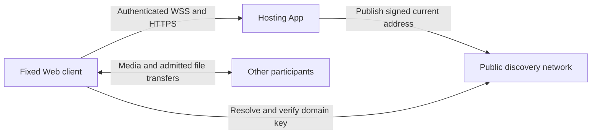

# Piik 3.0 Durable Rooms And Stable Entry

Reviewed 2026-10-27. This is the proposed storage, replication and address model,
requested before implementation. The [network model](./channel-network-design.md)
owns room/media lifecycles; the [prototype README](../../prototype/channel-server/README.md)
describes running behavior. [TODO](../todo.md) owns implementation and decisions.

## Recommended Ownership

Each room has one active confirming authority, hosted by the domain service or an
explicitly delegated room-owner App. The domain authority retains membership,
directory and delegation; it need not retain every room's history or attachments.
Initially the existing Rust coordinator hosts all room authorities. This is the
first deployment step, not a requirement for permanent central storage. Distribute
storage and file traffic before adding distributed writes; room responsibility
does not require a process per room.

| Owner | Responsibility |
| --- | --- |
| Domain owner | Manages members, roles, room directory and hosting delegation, without having to store every room's history and attachments. |
| Room owner | Manages that room's access and retention needs, and chooses an authorized host. Leaving a page or voice activity does not delete the room. |
| Hosting service | Checks current permission, confirms message order and commits authoritative data. Initially the existing Rust coordinator hosts every room. |
| History holder | Keeps authorized room history and supplies verifiable missing records. A copy grants neither management nor write authority. |
| Attachment holder | Retains complete verified content and serves it to authorized recipients. It need not retain other files. |

The coordinator retains membership and credential databases; ordinary history
copies contain only authorized conversation data. The current prototype already
separates room ownership from domain ownership. Do not add another permission
evaluator for replicas, files or a future hosting adapter.

## Writing And Replicating History

Keep a single confirmed order per room. Authorize a send, then commit its message,
retry nonce and retention changes in one transaction before acknowledging or
broadcasting it. A retry uses the original nonce. An unconfirmed message stays
pending; disconnection does not turn it into a second message or a confirmed one.

Replace the prototype's whole-authority clone and whole-channel JSON rewrite on
each durable command with incremental SQLite transactions. Keep the existing
bounded attachment BLOB store initially: separating responsibilities does not
require a new object store or database service.

Participants cache retained history for rooms they can access. Use IndexedDB for
Browser records and file caches, with bounded retention; localStorage remains
for small preferences and the initial bookmark list. Reconnect requests missing
records instead of replacing every room's history. A cache is not a permanent
archive; explicitly retained copies belong to a hosting/storage configuration.

First retain the existing trust in the authority's attribution and authorization.
The authority signs committed room records, binding domain, room, history
generation, position, previous digest, author and content. Verify copies with the
pinned domain identity, independently of the device supplying them. Use maintained
cryptographic libraries. This prevents ordinary holders from forging history;
protecting authors against the authority itself would additionally require author
signatures and is a separate trust-model decision. Verify against the room writer
authorized by the pinned domain identity; delegated hosts never receive the
domain's signing private key.

Only extend a valid committed history. A larger timestamp or sequence number is
not proof of validity; conflicting signed histories must not silently overwrite
each other. Signatures prove authenticity, not that an offline copy includes later
messages. A retained-window checkpoint provides a trusted boundary, so reading
recent history does not require downloading all earlier messages.

[Jami's signed conversation history](https://docs.jami.net/en_US/developer/jami-concepts/swarm.html)
is the reference for verified copies. Its multi-writer repository, administrator
voting and device-certificate system are not prerequisites for this first model.

## Files And Availability

A message contains the attachment's description, size and content digest; it does
not imply that another device has retained the bytes. The sender keeps the
original, recipients pull on demand, and a complete hash-verified copy can become
another source. A hosting service can retain files within an explicit quota.
Do not automatically copy every file to the domain owner or every participant.

The confirming room authority admits each transfer under channel policy for its
file, sender and recipient sessions. Initially this is the existing coordinator.
Bytes can then travel directly between those peers. Do not give a file
holder another user's long-lived credential. Transfers use the existing session
recovery deadline: access removal stops them, and lost authority does not create
a separate heartbeat or an indefinitely valid grant.

| Situation | Proposed behavior |
| --- | --- |
| Room owner leaves, hosting service stays online | Conversation continues; already admitted files remain available from their holders. |
| Original sender leaves, another holder stays online | Download from that holder after ordinary room authorization. |
| Confirming room service is unavailable | Read local history/files; new sends and remote downloads wait for that service to recover. |
| No content holder is online | Show that the file is waiting for a source, without declaring it deleted. |
| Message is withdrawn or access removed | Stop further authorized delivery and apply retention; already downloaded copies cannot be recalled. |

[Jami's file transfer design](https://jami.net/swarm-file-transfers/) separates
history synchronization from content availability in this way. The first Piik
version keeps online authorization, avoiding offline permission replication.

## Hosting, Upgrades And Recovery

Recommend persistent App-hosted channels for the 3.0 communication use case,
with explicit deletion. This would replace the earlier temporary-App proposal;
it does not change published 2.x behavior. Closing a client, stopping a hosting
process, leaving membership and deleting a room remain distinct operations.

Keep the data directory outside program/update files. Normal upgrades reopen it;
export/import is for backup and moving devices. Use the standard
[SQLite snapshot API](https://www.sqlite.org/backup.html), including current BLOB
attachments. Domain-host recovery preserves its domain identity and signing key
when introduced. A delegated room-host backup preserves its own writer identity
and delegation, never the domain private key or whole-domain credential database.
Conversation exports contain neither private keys nor credential databases.
State which external startup configuration
must be supplied separately. Captures, routes and live sessions do not restore.

Restore with the former writer stopped, validate the candidate and retain the
previous data until success. Once signed replicas exist, restoring an older
backup cannot reuse already-issued log positions. Recover valid later records
where available; an explicit rollback begins a new history generation at its
declared recovery point. Do not silently erase acknowledged history in other copies.

Planned room-hosting delegation can follow this design. Automatic takeover and
partitioned multi-writer chat are separate changes: they require deciding how
permission changes and conflicting writes converge, not just choosing the peer
with the most messages.

## Stable Entry Without A Piik Directory Server

The recommended experiment combines a fixed static Web client, a persistent
domain key and [pkarr signed address discovery](https://pubky.github.io/pkarr/docs/integration.html).
The user joins or saves a domain once; the App publishes address changes.

1. The App starts its public tunnel and publishes the current HTTPS address under
   the persistent domain key. It owns record refresh and updates after restarts.
2. An invitation opens the fixed Web client with the domain key and admission
   information. Invitation secrets remain in the private link, never in discovery.
3. The Browser resolves through an HTTPS relay and verifies the signed record.
   The endpoint must prove the expected domain identity against a fresh challenge
   before receiving an invitation, password or saved credential. A UUID, TLS
   hostname or the discovery record alone is not proof of endpoint key possession.
   The page stays at the fixed client origin and connects to that
   endpoint; it is not a redirect page.
4. Bookmarks, room caches and user credentials are partitioned by domain identity
   under this stable client origin. Tunnel replacement updates the endpoint without
   creating another user or moving the Browser's storage to a different origin.

The [Web Storage origin boundary](https://html.spec.whatwg.org/multipage/webstorage.html#the-localstorage-attribute)
makes the fixed client important. A public key lookup followed by redirecting to
the random tunnel address would still fragment identity and history storage.
The App's own browser entry likewise needs a stable origin or a native storage
owner; a changing loopback port is also an origin change.

This requires one selected-endpoint owner shared by signaling and attachments.
The prototype currently derives both from the page address. Keep WebSocket Origin
validation, first-message authentication, and ordinary HTTPS/WSS certificate checks;
authorize the fixed client origin in HTTP CORS for attachment requests. A signed
discovery name does not replace Browser TLS or make arbitrary HTTP endpoints secure.
See the [WebSocket](https://websockets.spec.whatwg.org/) and
[CORS](https://fetch.spec.whatwg.org/#http-cors-protocol) standards.

Piik need not run a dynamic directory, database or media proxy. The client can be
distributed through free static hosting; Cloudflare currently documents
[free static requests and asset storage](https://developers.cloudflare.com/workers/static-assets/billing-and-limitations/).
Ordinary visitors need no provider account or DNS setup. Hosting the static build
and maintaining its release still remain our work. Public discovery relays and
Cloudflare remain external availability dependencies, not services we control.

[Quick Tunnels](https://developers.cloudflare.com/tunnel/get-started/quick-tunnels/)
change hostnames and have no uptime guarantee. Discovery repairs address continuity;
it does not improve reachability of the tunnel provider. Keep direct user-supplied
URLs usable, and allow a stable user-owned endpoint through the same client flow.
No discovery service has been registered, deployed or integrated by this proposal.

## Delivery And Acceptance

Deliver incrementally: editable URL bookmarks; persistent data/backup and room
writes; fixed-client endpoint binding and signed discovery; then history replicas
and admitted file transfer. URL bookmarks already use one component in both
prototype surfaces, save only an origin and local label, and open a new tab to
preserve the current activity. They do not yet share storage between origins.

Before dependent implementation, agree persistent App hosting, trust in the
confirming authority and waiting for it during outages. Proposed acceptance:

- Concurrent room sends update only their durable records; failed writes receive
  no success acknowledgement. Reconnect retries do not duplicate messages.
- Closing the room owner's page preserves a separately hosted room; stopping its
  service preserves local history and gives pending operations an honest state.
- A holder supplies a file after its original sender leaves; modified content
  or records fail verification, and revoked access stops new/active delivery.
- Backup restoration preserves identity and avoids conflicting signed positions.
- Replacing the tunnel keeps the same bookmark, user, room history and fixed page;
  a wrong domain key receives no credential. Old addresses are not public invites.
- A Browser with no Piik App can join through the static client. Once loaded,
  unavailable discovery or domain hosting gives a recoverable connection state,
  not lost local data.
